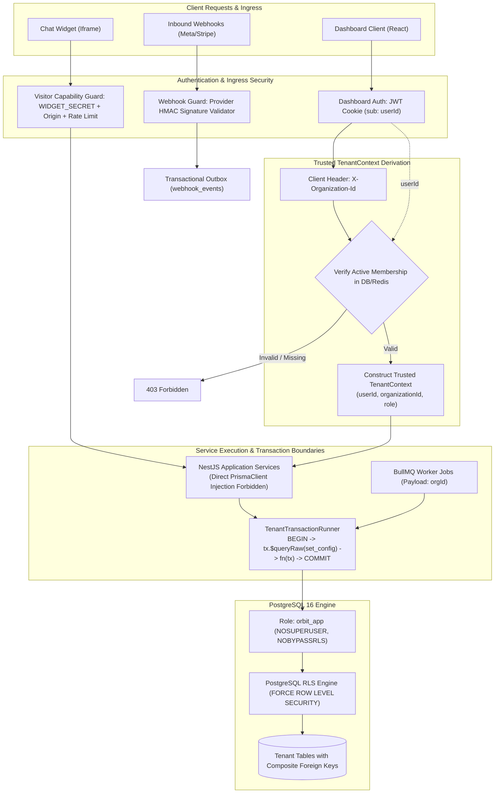

# PROJECT ORBIT: SYSTEM ARCHITECTURE & MULTI-TENANT SPECIFICATION

**Document Version:** 1.0.0 (Production Architecture Baseline)  
**Status:** Approved Architecture Baseline for Milestone 1  
**Target Milestone:** Milestone 1 (Monorepo Foundation, PostgreSQL RLS & Authentication)  
**Engineering Discipline:** Governed by Gravitas (6 Invariants — Core Skill Mode)

---

## 1. Executive Summary & Core Principles

Project Orbit is a multi-tenant AI-powered customer engagement SaaS built for small-to-medium businesses. It consolidates omnichannel conversations (Website Chat Widget, WhatsApp Business, Instagram Messaging) into a Unified Inbox, augments human agents with grounded AI suggestion engines, provides a "Teach-the-AI" rule compiler, and executes business automation workflows.

### 1.1 Architectural Principles
1. **Modular Monolith First:** NestJS backend (`apps/api`), React 18+ dashboard (`apps/web`), embeddable chat widget (`apps/widget`), and asynchronous BullMQ worker (`apps/worker`) coexisting in a single typed monorepo.
2. **Defensive Multi-Tenancy:** Multi-tenancy is enforced in depth: API guards, transactional PostgreSQL Row-Level Security (RLS) with `SET LOCAL`, composite foreign keys, and restricted runtime database roles.
3. **Stateless Scalability:** Application nodes retain zero in-memory session state; state is strictly partitioned across PostgreSQL 16 (relational truth & pgvector) and Redis 7 (sessions, queues, pub/sub).
4. **Provider-Independent Abstractions:** AI inference and messaging channels sit behind strict adapter interfaces with deterministic mock implementations, allowing 100% offline development and demoing without external API dependencies.

---

## 2. Gravitas Engineering Verification & Operating Mode

Gravitas is installed in the workspace as our engineering reliability runtime.

### 2.1 Diagnostic Status & Evidence
Diagnostic script executed at `python .agents/skills/gravitas/scripts/doctor.py`:
```json
{
  "gravitas_core_detected": true,
  "core_path": "H:\\orbit-saas\\.agents\\skills\\gravitas",
  "canonical_skill_sha256": "093c91dd12d1c78dee3fd31f93b1aad7aea454e7fe17f9b1f0f9a9cca7674553",
  "antigravity_cli_detected": false,
  "gravitas_native_detected": false,
  "native_plugin_path": null,
  "native_plugin_enabled": false,
  "native_hooks_available": false
}
```

### 2.2 Operational Mode
- **Mode:** **Core Skill Mode** (prompt-based behavioral discipline, decision records, evidence-backed verification).
- **The Six Invariants Enforced:**
  1. *Ground before mutating:* Inspect file state, tests, and callers before editing.
  2. *Stay in declared scope:* Confine modifications strictly to task boundaries.
  3. *Completion needs evidence:* No task is complete without executed command proof.
  4. *Never exact-retry a failure:* Diagnose root cause before retrying failed steps.
  5. *Satisfy the contract:* Acceptance criteria gate completion.
  6. *Say what you can't verify:* Explicitly report limitations and mock boundaries.

---

## 3. High-Level Architecture & Unified Security Flow



---

## 4. PostgreSQL RLS & Database Security Architecture

### 4.1 RLS Threat Model & Boundary Reality
- **Application Setting Boundary:** `app.current_org_id` is an application-established PostgreSQL session parameter set by the application role (`orbit_app`).
- **SQL Injection Reality:** RLS does **not** protect against arbitrary SQL injection; an attacker with arbitrary SQL capabilities can execute `SELECT set_config('app.current_org_id', 'target-org-id', true);` to hijack context.
- **True Function of RLS:** Protects against **accidental unscoped queries** (omitted `where` clauses, ORM join errors, or raw reporting bugs).
- **Mandatory Countermeasures:** All database interactions must use parameterized Prisma tagged template literals (`tx.$queryRaw`) or the Prisma query builder. Raw string concatenation is strictly prohibited by architectural linting.

### 4.2 Database Roles & Least-Privilege Permissions
- **`orbit_migrator` (Schema Migration Role):**
  - Schema owner for `public`.
  - Permissions: `NOSUPERUSER`, `BYPASSRLS`, `NOCREATEDB`, `NOCREATEROLE`. Full DDL privileges.
  - Used strictly in CI/CD and deployment via `prisma migrate deploy`.
- **`orbit_app` (Application Runtime Role):**
  - Restricted runtime user for NestJS API and BullMQ worker.
  - Permissions: `NOSUPERUSER`, `NOBYPASSRLS`, `NOCREATEDB`, `NOCREATEROLE`.
  - Granted `SELECT, INSERT, UPDATE, DELETE` on all tables, and `USAGE, SELECT` on all sequences.
  - **Guarantee:** `orbit_app` cannot alter schema definitions or bypass RLS under any circumstances.

```sql
-- Role Provisioning
CREATE ROLE orbit_migrator WITH LOGIN PASSWORD 'MIGRATOR_SECRET' NOSUPERUSER BYPASSRLS NOCREATEDB NOCREATEROLE;
CREATE ROLE orbit_app WITH LOGIN PASSWORD 'APP_SECRET' NOSUPERUSER NOBYPASSRLS NOCREATEDB NOCREATEROLE;

ALTER SCHEMA public OWNER TO orbit_migrator;
GRANT USAGE, CREATE ON SCHEMA public TO orbit_migrator;
GRANT USAGE ON SCHEMA public TO orbit_app;

ALTER DEFAULT PRIVILEGES FOR ROLE orbit_migrator IN SCHEMA public
  GRANT SELECT, INSERT, UPDATE, DELETE ON TABLES TO orbit_app;

ALTER DEFAULT PRIVILEGES FOR ROLE orbit_migrator IN SCHEMA public
  GRANT USAGE, SELECT ON SEQUENCES TO orbit_app;

REVOKE CREATE ON SCHEMA public FROM PUBLIC;
REVOKE ALL ON DATABASE orbit_db FROM PUBLIC;
```

### 4.3 Corrected `TenantTransactionRunner` Implementation
In PostgreSQL, `SELECT set_config(...)` is a value-returning scalar query. Prisma's `$queryRaw` is the correct method:

```typescript
// packages/database/src/tenant-transaction-runner.ts
import { Injectable, InternalServerErrorException } from '@nestjs/common';
import { PrismaClient, Prisma } from '@prisma/client';

export type TenantTransactionalClient = Prisma.TransactionClient;

@Injectable()
export class TenantTransactionRunner {
  constructor(private readonly prisma: PrismaClient) {}

  async runWithTenant<T>(
    organizationId: string,
    fn: (tx: TenantTransactionalClient) => Promise<T>,
    options?: {
      isolationLevel?: Prisma.TransactionIsolationLevel;
      timeoutMs?: number;
    }
  ): Promise<T> {
    if (!organizationId) {
      throw new InternalServerErrorException('Tenant context missing: organizationId required');
    }

    return this.prisma.$transaction(
      async (tx) => {
        // Correct query method: $queryRaw executes SELECT set_config
        // 3rd param 'true' sets is_local = true (scoped strictly to transaction)
        await tx.$queryRaw`SELECT set_config('app.current_org_id', ${organizationId}, true)`;

        // Execute all operations strictly through tx
        return await fn(tx);
      },
      {
        isolationLevel: options?.isolationLevel ?? Prisma.TransactionIsolationLevel.ReadCommitted,
        timeout: options?.timeoutMs ?? 10000,
      }
    );
  }
}
```

---

## 5. Data Classification & Relational Integrity

### 5.1 Classification Matrix
All data containing customer messages, PII, prompts, or costs are classified as **Tenant-Owned** and governed by PostgreSQL RLS.

| Table Name | Scope | Tenant Isolation Mechanism | Justification |
|---|---|---|---|
| `users` | **Global** | Identity Guard / Unique Email | Global credentials across organizations. |
| `user_sessions` | **Global** | `userId` Foreign Key | Global refresh token sessions per user. |
| `organizations` | **Global / Root** | Membership Verification | Root tenant container. |
| `organization_memberships` | **Global / Pivot** | `(userId, organizationId)` Unique | Maps global users to organizations with RBAC roles. |
| `channels` | **Tenant-Owned** | RLS + Composite FK | Soft-deleted communication endpoints. |
| `channel_credentials` | **Tenant-Owned** | RLS + Composite FK | Encrypted API keys per channel. |
| `contacts` | **Tenant-Owned** | RLS + Composite FK | CRM customer profiles isolated per tenant. |
| `conversations` | **Tenant-Owned** | RLS + Composite FK | Customer inquiry threads. |
| `messages` | **Tenant-Owned** | RLS + Composite FK | Customer and agent message history. |
| `webhook_events` | **Tenant-Owned** | RLS + Composite FK + Outbox | Raw customer webhooks with processing leases. |
| `ai_requests` | **Tenant-Owned** | RLS + `organization_id` FK | Logical customer AI turns. |
| `ai_request_attempts` | **Tenant-Owned** | RLS + Composite FK | Raw provider invocations, costs, and attempts. |
| `ai_reservations` | **Tenant-Owned** | RLS + `organization_id` FK | Durable token quota reservation ledger. |
| `usage_records` | **Tenant-Owned** | RLS + Composite Unique | Monthly aggregate usage quotas. |
| `audit_logs` | **Tenant-Owned** | RLS + `organization_id` FK | Immutable compliance audit trail. |

### 5.2 Channel Soft-Deletion & Relational Retention
Webhooks and messages contain customer communication audit logs and delivery records. A channel deletion must **never** orphan or destroy an organization's legal/audit event history.
- **Soft Deletion of Channels:** `channels` table includes `deleted_at TIMESTAMPTZ NULL`.
- When an admin deletes a channel, `deleted_at = NOW()` is set, disabling active webhook routing while preserving historical relational integrity.
- In `webhook_events`, `channel_id` references `channels(id) ON DELETE RESTRICT`. A channel cannot be hard-deleted while historical webhooks exist, and `organization_id` remains `NOT NULL`:
  ```sql
  CONSTRAINT fk_webhook_channel_org
    FOREIGN KEY (channel_id, organization_id)
    REFERENCES channels (id, organization_id)
    ON DELETE RESTRICT
  ```

---

## 6. Recoverable Webhook Ingestion & Transactional Outbox

### 6.1 Scoped Idempotency & Schema
To prevent cross-tenant key collisions and support multi-tenant providers, idempotency is scoped to `(organization_id, provider, idempotency_key)`:

```sql
CREATE TABLE webhook_events (
  id UUID PRIMARY KEY DEFAULT gen_random_uuid(),
  organization_id UUID NOT NULL REFERENCES organizations(id) ON DELETE CASCADE,
  channel_id UUID NOT NULL,
  provider VARCHAR(32) NOT NULL,          -- 'META', 'STRIPE'
  idempotency_key VARCHAR(255) NOT NULL,  -- e.g. 'wamid.HBgL...' or 'evt_1...'
  status VARCHAR(24) NOT NULL DEFAULT 'RECEIVED', -- 'RECEIVED', 'QUEUED', 'PROCESSING', 'PROCESSED', 'FAILED', 'DEAD_LETTER'
  payload JSONB NOT NULL,
  attempt_count INT NOT NULL DEFAULT 0,
  max_attempts INT NOT NULL DEFAULT 5,
  lease_token UUID,                       -- Cryptographic fencing token
  lease_expires_at TIMESTAMPTZ,           -- Processing lease expiration
  last_error TEXT,
  next_retry_at TIMESTAMPTZ,              -- Exponential backoff scheduling
  created_at TIMESTAMPTZ NOT NULL DEFAULT NOW(),
  updated_at TIMESTAMPTZ NOT NULL DEFAULT NOW(),
  processed_at TIMESTAMPTZ,
  CONSTRAINT uq_webhook_tenant_event UNIQUE(organization_id, provider, idempotency_key),
  CONSTRAINT fk_webhook_channel_org FOREIGN KEY (channel_id, organization_id)
    REFERENCES channels (id, organization_id) ON DELETE RESTRICT
);
```

### 6.2 Fencing Tokens & Lease Lifecycle
1. **Queue Deduplication vs. Durable Correctness:** BullMQ job IDs (`jobId = webhookEvent.id`) provide queue-level deduplication. PostgreSQL lease tokens and database unique constraints provide durable correctness.
2. **Atomic Lease Acquisition:**
   ```sql
   UPDATE webhook_events
   SET status = 'PROCESSING',
       lease_token = :newLeaseToken,
       lease_expires_at = NOW() + INTERVAL '60 seconds',
       attempt_count = attempt_count + 1,
       updated_at = NOW()
   WHERE id = :id
     AND (status IN ('RECEIVED', 'QUEUED') OR (status = 'PROCESSING' AND lease_expires_at < NOW()))
     AND (next_retry_at IS NULL OR next_retry_at <= NOW())
   RETURNING id, organization_id, payload, lease_token;
   ```
3. **Lease Heartbeat:** Long-running jobs run a 20s background timer refreshing `lease_expires_at = NOW() + 60s` where `lease_token = :myLeaseToken`. If 0 rows are updated, the worker recognizes lease loss and immediately aborts.
4. **Fenced Conditional Completion:** The worker transitions to `PROCESSED` strictly conditional on holding the current fencing token:
   ```sql
   UPDATE webhook_events
   SET status = 'PROCESSED',
       processed_at = NOW(),
       lease_token = NULL,
       lease_expires_at = NULL,
       updated_at = NOW()
   WHERE id = :id AND lease_token = :myLeaseToken;
   ```
5. **Payload Retention & PII Scrubbing:**
   - Raw payloads contain customer PII. Retention is limited to 30 days.
   - An automated cron job purges payload contents after 30 days (`payload = '{}'`), retaining event metadata for compliance audits.
   - Access to raw payloads is restricted to internal workers and Business Owners with `VIEW_AUDIT_LOGS` permissions.

---

## 7. AI Quota Reservation, Accounting & Timeout Reconciliation

### 7.1 Durable Reservation State Machine
To prevent silent quota loss or duplicate billing, token reservation uses a durable PostgreSQL table `ai_reservations` paired with Redis:

```sql
CREATE TABLE ai_reservations (
  id UUID PRIMARY KEY DEFAULT gen_random_uuid(),
  organization_id UUID NOT NULL REFERENCES organizations(id) ON DELETE CASCADE,
  request_id UUID NOT NULL UNIQUE,
  status VARCHAR(24) NOT NULL DEFAULT 'RESERVED', -- 'RESERVED', 'COMMITTED', 'RELEASED', 'ABANDONED'
  estimated_tokens INT NOT NULL,
  fencing_token UUID NOT NULL,
  heartbeat_at TIMESTAMPTZ NOT NULL DEFAULT NOW(),
  created_at TIMESTAMPTZ NOT NULL DEFAULT NOW()
);
```

### 7.2 Late Response Handling & Exactly-Once Reconciliation
- The Redis sweeper never silently discards a reservation. If a process stops heartbeating, it flags the reservation `ABANDONED` in PostgreSQL.
- If an in-flight provider response returns late, it presents `(reservation_id, fencing_token)`.
- The database transaction validates the fencing token and transitions the status to `COMMITTED`.
- The actual token usage is written to `ai_usage_events` and committed to `usage_records`.
- Unique constraint on `request_id` guarantees exactly-once billing: late provider usage is captured, but duplicate charging is mathematically impossible.

### 7.3 Quota Under-Reservation Handling
- When actual token usage exceeds the reserved estimate (e.g. 2,000 estimated, 2,850 actual):
  - Reconciliation commits the full 2,850 tokens to `committed` usage and decrements `reserved_sum` by 2,000.
  - If this results in `committed > monthly_limit`, the tenant enters an overdraft state.
  - The next reservation evaluates `committed + reserved_sum + requested <= monthly_limit`. Because `committed > monthly_limit`, all subsequent reservation requests are rejected immediately with `QuotaExceededException`.

### 7.4 Provider Timeout Reconciliation
- On client-side timeouts (e.g. at 30s), the HTTP connection is severed before headers arrive; `openai_request_id` is never received.
- Timed-out calls log `status = 'TIMEOUT', cost_status = 'ESTIMATED_PENDING_AUDIT'` with estimated max tokens. **Cost is never treated as zero.**
- The customer is billed only for the successful conversation turn. Timeout overhead is classified under SaaS platform COGS with `is_tenant_billable = false`.
- At month-end, an automated reconciliation job ingests OpenAI's monthly organization usage report and computes `unreconciled_provider_variance_usd`, giving complete financial auditability.

---

## 8. Website-Widget Security Perimeter

1. **Signed Visitor Session / Capability Token:**
   - Issued to website visitors upon session initialization. Proves server-issued authorization to post to a specific ephemeral conversation, **not** real-world user identity.
   - Dedicated `WIDGET_JWT_SECRET`. Claims: `{ sub: visitorId, channelId: channel.id, orgId: channel.organizationId, type: 'WIDGET_VISITOR', exp: now + 24h }`.
2. **Strict Perimeter:** `WidgetGuard` restricts visitor tokens strictly to `/api/widget/*`. Cannot access dashboard routes (`/api/v1/*`).
3. **Browser Origin Validation:** Additional browser control: `Origin` header must match `channels.config.allowed_domains`.
4. **Rate Limiting:** Redis token-bucket: 10 messages/min per visitor, 50 session inits/min per IP.

---

## 9. Evidence-Based AI Answer Verification

Vector similarity is a retrieval relevance metric, **not** proof of factual correctness.
- **Evidence Coverage Check:** An extractive NLI step validates that generated prices, dates, and policies exist verbatim within cited knowledge chunks.
- **In-Text Source Citations:** Model must include provenance tags `[Source #K]`.
- **Contradiction Detection:** Conflicting chunks trigger `CONTRADICTORY_EVIDENCE` and halt generation.
- **Insufficient-Evidence Abstention:** When knowledge is absent, the model abstains and invokes `escalate_to_human`.
- **Evaluation Strategy:** Shared domain evaluation datasets (`evals/benchmarks/ecommerce.json`) in CI, supplemented by tenant-specific evaluation when >50 verified FAQs exist.

---

## 10. PostgreSQL RLS Integration Testing Strategy

Unit tests and mocks cannot prove RLS correctness. Real integration tests must execute against a real PostgreSQL 16 database (`tests/integration/rls-isolation.spec.ts`):

1. **Cross-Tenant Reads:** Tenant A queries Tenant B's conversations -> returns 0 rows.
2. **Cross-Tenant Writes:** Tenant A updates Tenant B's record -> affects 0 rows.
3. **Cross-Tenant Inserts:** Tenant A inserts record with Tenant B's `organization_id` -> fails `WITH CHECK`.
4. **Organization Switching:** Toggling `app.current_org_id` dynamically changes data visibility within the same session.
5. **Transaction Rollback:** `ROLLBACK` clears both data changes and session settings; next transaction on pooled connection starts unpolluted.
6. **Worker Execution:** Background job processor running inside `runWithTenant` operates under the correct tenant boundary.
7. **Missing Context:** Querying without setting `app.current_org_id` returns 0 rows or fails.

---

## 11. Milestone 1 Scope & Measurable Acceptance Criteria

Milestone 1 remains strictly locked to foundational infrastructure:
1. **Monorepo Foundation:** Modern npm workspaces (`apps/web`, `apps/api`, `packages/shared`, `packages/validation`, `packages/config`).
2. **Docker Compose:** PostgreSQL 16 (`pgvector`) + Redis 7 Alpine.
3. **Database Roles & Migrations:** `orbit_migrator` (DDL) and `orbit_app` (`NOSUPERUSER, NOBYPASSRLS`). Core entities: `User`, `Organization`, `OrganizationMembership`, `UserSession`.
4. **TenantTransactionRunner:** Implementation of transactional `SET LOCAL` runner with composite foreign keys and RLS policies.
5. **Authentication & Sessions:** User registration, login with Argon2id, HTTP-only JWT cookies, refresh token rotation with theft reuse detection, and session revocation.
6. **Unified TenantContext & Authorization:** `TenantGuard` verifying active membership before creating trusted `TenantContext`.
7. **Automated RLS Tenant-Isolation Test Suite:** Integration tests executing against real PostgreSQL proving cross-tenant isolation.
8. **Minimal Authenticated Dashboard:** React dashboard displaying user profile, active organization, workspace switcher, and logout.

---

*End of Architecture Specification.*
