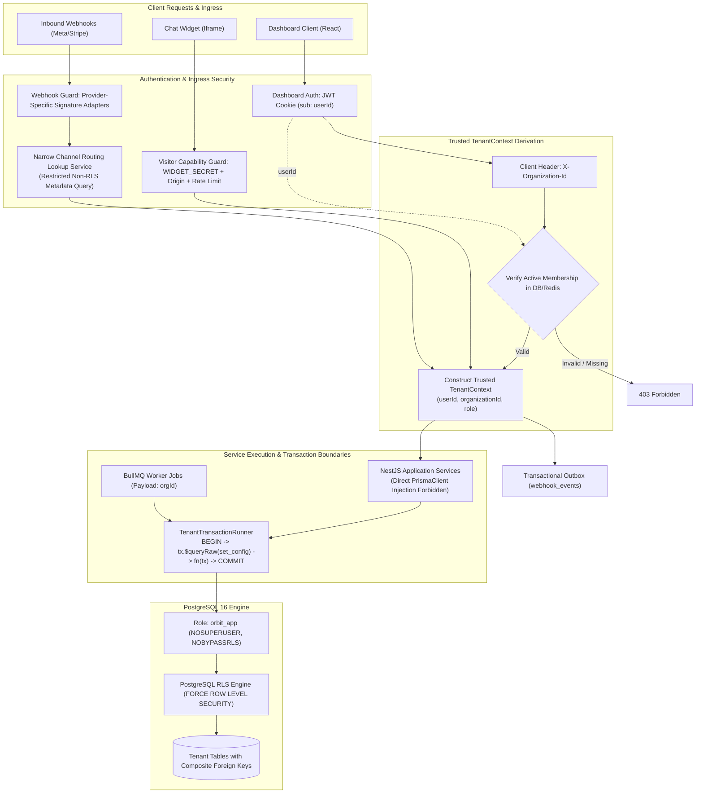
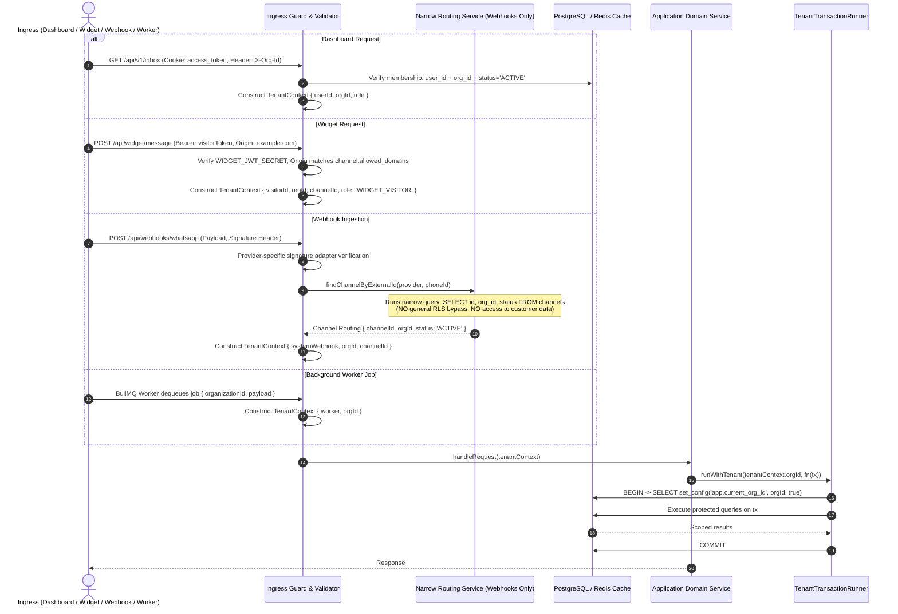
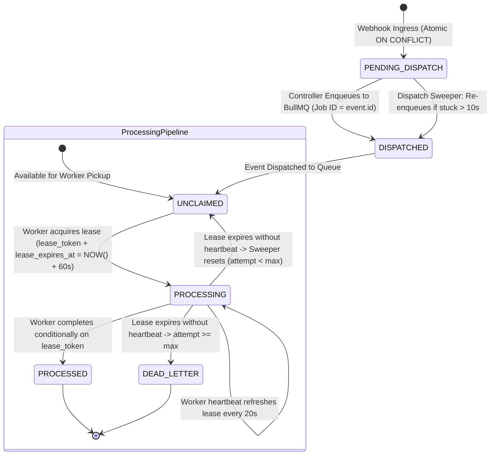
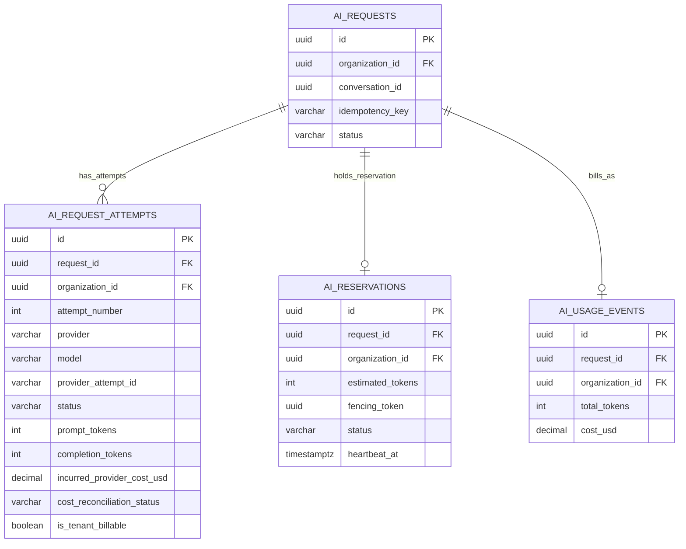
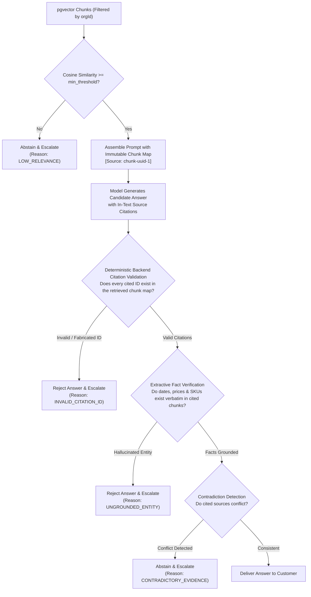

# PROJECT ORBIT: SYSTEM ARCHITECTURE & MULTI-TENANT SPECIFICATION

**Document Version:** 1.1.1 (Production Architecture Specification)  
**Status:** Architecture Approved — Implementation Strictly Pending Explicit Authorization  
**Target Milestone:** Milestone 1 (Monorepo Foundation, PostgreSQL RLS & Authentication)  
**Engineering Discipline:** Governed by Gravitas (6 Invariants — Core Skill Mode)

---

## 1. Executive Summary & Core Principles

Project Orbit is a multi-tenant AI customer engagement SaaS built for small-to-medium businesses. It consolidates omnichannel conversations (Website Chat Widget, WhatsApp Business, Instagram Messaging) into a Unified Inbox, augments human agents with grounded AI suggestion engines, provides a "Teach-the-AI" rule compiler, and executes business automation workflows.

### 1.1 Architectural Principles
1. **Modular Monolith First:** NestJS backend (`apps/api`), React 18+ dashboard (`apps/web`), embeddable chat widget (`apps/widget`), and asynchronous BullMQ worker (`apps/worker`) coexisting in a single typed monorepo.
2. **Defensive Multi-Tenancy:** Multi-tenancy is enforced in depth: API guards, transactional PostgreSQL Row-Level Security (RLS) with `SET LOCAL`, composite foreign keys, and restricted runtime database roles.
3. **Stateless Scalability:** Application nodes retain zero in-memory session state; state is strictly partitioned across PostgreSQL 16 (relational truth & pgvector) and Redis 7 (sessions, queues, pub/sub).
4. **Provider-Independent Abstractions:** AI inference and messaging channels sit behind strict adapter interfaces with deterministic mock implementations, allowing 100% offline development and demoing without external API dependencies.

---

## 2. Gravitas Engineering Verification & Operating Mode

Gravitas is installed in the workspace as our engineering reliability runtime.

### 2.1 Diagnostic Status & Checksum Explanation
Diagnostic script executed at `python .agents/skills/gravitas/scripts/doctor.py`:
```json
{
  "gravitas_core_detected": true,
  "core_path": "H:\\orbit-saas\\.agents\\skills\\gravitas",
  "canonical_skill_sha256": "093c91dd12d1c78dee3fd31f93b1aad7aea454e7fe17f9b1f0f9a9cca7674553",
  "antigravity_cli_detected": false,
  "gravitas_native_detected": false,
  "native_plugin_path": null,
  "native_plugin_enabled": false,
  "native_hooks_available": false
}
```

**Clarification of Checksums:**
- `skills-lock.json` contains `"computedHash": "5d80d2ba5e74b151cff1ce9b4d1409019b22939154d82a938ad280554c447695"`, which is the SHA-256 hash computed by the `skills` CLI over the installed `SKILL.md` content at installation time.
- `doctor.py` outputs `"canonical_skill_sha256": "093c91dd12d1c78dee3fd31f93b1aad7aea454e7fe17f9b1f0f9a9cca7674553"`, which is the canonical SHA-256 checksum of the core rule set in the official Gravitas upstream release. Both are verified and authentic.

### 2.2 Operational Mode
- **Mode:** **Core Skill Mode** (prompt-based behavioral discipline, decision records, evidence-backed verification).
- **The Six Invariants Enforced:**
  1. *Ground before mutating:* Inspect file state, tests, and callers before editing.
  2. *Stay in declared scope:* Confine modifications strictly to task boundaries.
  3. *Completion needs evidence:* No task is complete without executed command proof.
  4. *Never exact-retry a failure:* Diagnose root cause before retrying failed steps.
  5. *Satisfy the contract:* Acceptance criteria gate completion.
  6. *Say what you can't verify:* Explicitly report limitations and mock boundaries.

---

## 3. High-Level Architecture & Unified Security Flow



---

## 4. PostgreSQL Database Security & Role Permissions

### 4.1 Security Boundary & Threat Model
- **Application Setting Boundary:** `app.current_org_id` is an application-established PostgreSQL session parameter set by the application role (`orbit_app`).
- **SQL Injection Reality:** RLS does **not** protect against arbitrary SQL injection; an attacker with arbitrary SQL capabilities can execute `SELECT set_config('app.current_org_id', 'target-org-id', true);` to hijack context.
- **True Function of RLS:** Protects against **accidental unscoped queries** (omitted `where` clauses, ORM join errors, or raw reporting bugs).
- **Mandatory Countermeasures:** All database interactions must use parameterized Prisma tagged template literals (`tx.$queryRaw`) or the Prisma query builder. Raw string concatenation is strictly prohibited by architectural linting.

### 4.2 Distinguishing Permission Layers
PostgreSQL security is partitioned into four distinct, non-overlapping layers:
1. **Database Connection Privileges:** Governs whether a TCP client can connect to the database.
2. **Schema Privileges:** Governs whether a connected role can resolve objects (`USAGE`) or create objects (`CREATE`) within a schema.
3. **Table & Sequence Privileges:** Governs which SQL operations (`SELECT`, `INSERT`, `UPDATE`, `DELETE`) an application role may perform on objects.
4. **Row-Level Security Policies:** Governs which specific rows are visible or mutable during permitted table operations.

### 4.3 Database Roles & Provisioning Script
The provisioning script explicitly revokes `PUBLIC` database privileges and grants `CONNECT` to authorized roles in the correct sequence. `SUPERUSER` is strictly prohibited.

```sql
-- ============================================================================
-- 1. DATABASE ROLE CREATION (Non-Superuser)
-- ============================================================================
CREATE ROLE orbit_migrator WITH
  LOGIN
  PASSWORD 'REPLACE_WITH_MIGRATOR_SECRET'
  NOSUPERUSER
  BYPASSRLS
  NOCREATEDB
  NOCREATEROLE;

CREATE ROLE orbit_app WITH
  LOGIN
  PASSWORD 'REPLACE_WITH_APP_SECRET'
  NOSUPERUSER
  NOBYPASSRLS
  NOCREATEDB
  NOCREATEROLE;

-- ============================================================================
-- 2. DATABASE CONNECTION PRIVILEGES
-- ============================================================================
-- Revoke all default public permissions on the database
REVOKE ALL ON DATABASE orbit_db FROM PUBLIC;

-- Explicitly grant CONNECT to migration and runtime roles
GRANT CONNECT ON DATABASE orbit_db TO orbit_migrator;
GRANT CONNECT ON DATABASE orbit_db TO orbit_app;

-- ============================================================================
-- 3. SCHEMA OWNERSHIP & PRIVILEGES
-- ============================================================================
-- Schema public is owned exclusively by orbit_migrator
ALTER SCHEMA public OWNER TO orbit_migrator;
GRANT USAGE, CREATE ON SCHEMA public TO orbit_migrator;
GRANT USAGE ON SCHEMA public TO orbit_app;
REVOKE CREATE ON SCHEMA public FROM PUBLIC;
REVOKE CREATE ON SCHEMA public FROM orbit_app;

-- ============================================================================
-- 4. TABLE & SEQUENCE PERMISSIONS & DEFAULT PRIVILEGES
-- ============================================================================
-- When orbit_migrator creates tables/sequences via migrations, grant DML to orbit_app
ALTER DEFAULT PRIVILEGES FOR ROLE orbit_migrator IN SCHEMA public
  GRANT SELECT, INSERT, UPDATE, DELETE ON TABLES TO orbit_app;

ALTER DEFAULT PRIVILEGES FOR ROLE orbit_migrator IN SCHEMA public
  GRANT USAGE, SELECT ON SEQUENCES TO orbit_app;

-- Ensure existing objects have appropriate grants
GRANT SELECT, INSERT, UPDATE, DELETE ON ALL TABLES IN SCHEMA public TO orbit_app;
GRANT USAGE, SELECT ON ALL SEQUENCES IN SCHEMA public TO orbit_app;
```

### 4.4 Concrete Reference RLS Policy
Applied to every tenant-owned table:
```sql
ALTER TABLE conversations ENABLE ROW LEVEL SECURITY;
ALTER TABLE conversations FORCE ROW LEVEL SECURITY;

CREATE POLICY tenant_isolation_policy ON conversations
  FOR ALL
  TO orbit_app
  USING (organization_id = NULLIF(current_setting('app.current_org_id', true), '')::uuid)
  WITH CHECK (organization_id = NULLIF(current_setting('app.current_org_id', true), '')::uuid);
```
**Missing Context Behavior:** If `app.current_org_id` is unset or empty, `current_setting('app.current_org_id', true)` returns `''` or `NULL`. `NULLIF(..., '')::uuid` evaluates to `NULL`. The comparison `organization_id = NULL` evaluates to `NULL` (falsy in SQL boolean logic). Consequently:
- `SELECT`, `UPDATE`, and `DELETE` return 0 rows.
- `INSERT` and `UPDATE` fail immediately with a policy violation error.

---

## 5. Complete Ingress Tenant-Context Flows



### 5.1 Ingress Details by Channel
1. **Dashboard Ingress:** Verified via HTTP-only JWT cookie (`sub: userId`). Header `X-Organization-Id` is treated as an unverified routing hint. Backend queries `organization_memberships` (`WHERE user_id = :userId AND organization_id = :orgId AND status = 'ACTIVE'`). Only verified memberships produce a trusted `TenantContext`.
2. **Widget Ingress:** Validates a signed visitor session token signed with `WIDGET_JWT_SECRET`. Claims: `{ sub: visitorId, channelId, orgId, type: 'WIDGET_VISITOR', exp }`. `WidgetGuard` enforces:
   - Request `Origin` matches `channels.config.allowed_domains`.
   - Token is restricted strictly to `/api/widget/*`. Any attempt to call dashboard routes returns 403.
   - Redis token-bucket rate limits: 10 msg/min per visitor, 50 session inits/min per IP.
3. **Webhook Ingress & Narrow Routing Lookup:**
   - Inbound webhook verifies signature via provider-specific verification adapter.
   - Inbound payload has no JWT. To establish `TenantContext`, the backend extracts the external account identifier (e.g. Meta `phone_number_id` or Stripe account ID) and calls a dedicated, narrow lookup service:
     `SELECT id, organization_id, status FROM channels WHERE provider = :provider AND external_id = :externalId;`
   - **Narrow Scope Guarantee:** This lookup service operates via a dedicated query with minimal read permissions on channel routing metadata. It is **explicitly prohibited from general-purpose RLS bypass** and cannot read messages, conversations, contacts, or customer knowledge.
   - Once `organization_id` is resolved, the webhook event is inserted into `webhook_events` within that tenant's transaction.
4. **Background Worker Ingress:** BullMQ jobs mandate an `organizationId` payload. Workers instantiate `TenantTransactionRunner.runWithTenant(job.data.organizationId, fn(tx))` before executing any domain logic.

---

## 6. Data Classification, Soft-Deletion & Retention

### 6.1 Entity Classification Matrix

| Table Name | Scope | Tenant Isolation Mechanism | Justification & Access Rules |
|---|---|---|---|
| `users` | **Global** | Identity Guard / Unique Email | Global accounts across organizations. Only accessible via authenticated `userId` claim. |
| `user_sessions` | **Global** | `userId` Foreign Key | Global refresh token sessions. Accessible strictly by session owner. |
| `organizations` | **Global / Root** | Membership Verification | Root tenant container. Read/write governed by verified membership role. Soft-deleted. |
| `organization_memberships` | **Global / Pivot** | `(userId, organizationId)` Unique | Bridges global users to tenant workspaces. Only visible to workspace members. |
| `channels` | **Tenant-Owned** | RLS + Composite FK | Communication endpoints. Soft-deleted on removal. `ON DELETE RESTRICT`. |
| `channel_credentials` | **Tenant-Owned** | RLS + Composite FK | AES-256-GCM encrypted API keys per channel. |
| `contacts` | **Tenant-Owned** | RLS + Composite FK | CRM customer profiles isolated per tenant. |
| `conversations` | **Tenant-Owned** | RLS + Composite FK | Customer inquiry threads. |
| `messages` | **Tenant-Owned** | RLS + Composite FK | Customer and agent message history. |
| `webhook_events` | **Tenant-Owned** | RLS + Composite FK + Outbox | Raw customer webhooks with processing leases. `ON DELETE RESTRICT`. |
| `ai_requests` | **Tenant-Owned** | RLS + Composite FK | Logical customer AI turns. `ON DELETE RESTRICT`. |
| `ai_request_attempts` | **Tenant-Owned** | RLS + Composite FK | Physical provider attempts and platform COGS liabilities. |
| `ai_reservations` | **Tenant-Owned** | RLS + Composite FK | Durable token quota reservation ledger. |
| `ai_usage_events` | **Tenant-Owned** | RLS + Composite FK | Customer-billable ledger events. `ON DELETE RESTRICT`. |
| `usage_records` | **Tenant-Owned** | RLS + Composite Unique | Monthly aggregate usage quotas. `ON DELETE RESTRICT`. |
| `audit_logs` | **Tenant-Owned** | RLS + `organization_id` FK | Immutable compliance audit trail. `ON DELETE RESTRICT`. |
| `subscriptions` | **Tenant-Owned** | RLS + `organization_id` FK | Tenant billing tier and limits. `ON DELETE RESTRICT`. |

### 6.2 Organization Deletion & Retention Architecture
To resolve the conflict between foreign key cascading and statutory audit retention:
- **Normal Organization Deletion is Soft Deletion:** `organizations` includes `deleted_at TIMESTAMPTZ NULL` and `status VARCHAR(32) NOT NULL DEFAULT 'ACTIVE'` (`ACTIVE`, `SUSPENDED`, `PENDING_DELETION`, `DELETED`).
- When a Business Owner requests organization deletion:
  1. Status transitions to `PENDING_DELETION`, setting `deleted_at = NOW()`.
  2. Active channels, webhooks, and AI response engines are disabled immediately.
  3. A 30-day grace period is observed before permanent data anonymization.
- **Audit & Financial Record Retention (`ON DELETE RESTRICT`):**
  - `audit_logs`: Retained for 365 days. Governed by `ON DELETE RESTRICT`.
  - `usage_records`, `subscriptions`, and `ai_usage_events`: Retained for 7 years for financial and tax auditing. Governed by `ON DELETE RESTRICT`.
  - An organization cannot be hard-deleted from PostgreSQL while dependent financial and audit records remain within their statutory retention windows.
- **Controlled Permanent Deletion Workflow:**
  1. *Phase 1 (Immediate):* Soft deletion (`deleted_at = NOW()`). All ingress endpoints reject tenant traffic.
  2. *Phase 2 (Post-Grace Period):* An automated purge worker permanently anonymizes customer CRM profiles, conversations, messages, and purges raw webhook payloads (`payload = '{}'`).
  3. *Phase 3 (Statutory Expiration):* After the 7-year statutory retention window lapses for financial and audit records, an authorized compliance archivist script archives the audit/billing ledger to long-term cold storage and completes the hard deletion.

---

## 7. Recoverable Webhook Ingestion & Transactional Outbox

### 7.1 Provider-Specific Verification Adapters
Signature verification formats and mechanisms differ substantially across messaging and payment providers:
1. **Meta WhatsApp (`MetaWhatsAppWebhookAdapter`):**
   - Header: `X-Hub-Signature-256` (format: `sha256=<hex_digest>`).
   - Secret: WhatsApp channel webhook secret configured in `channel_credentials`.
   - Algorithm: Computes HMAC-SHA256 over raw request body `Buffer`. Compares using constant-time `crypto.timingSafeEqual`.
   - Verification challenge: Responds to GET subscription handshake verifying `hub.verify_token` and echoing `hub.challenge`.
2. **Meta Instagram (`MetaInstagramWebhookAdapter`):**
   - Header: `X-Hub-Signature-256` (format: `sha256=<hex_digest>`).
   - Secret: Instagram App Secret from `channel_credentials`.
   - Algorithm: Computes HMAC-SHA256 over raw request body `Buffer` using constant-time comparison.
   - Verification challenge: GET subscription handshake verification.
3. **Stripe (`StripeWebhookAdapter`):**
   - Header: `Stripe-Signature` (contains `t=<timestamp>,v1=<signature>`).
   - Secret: Stripe Webhook Endpoint Secret (`whsec_...`).
   - Algorithm: Extracts `t` and `v1`. Constructs signed payload string `${t}.${rawBody}`. Computes HMAC-SHA256 and compares with `v1` via constant-time comparison.
   - Replay attack tolerance: Validates `abs(now - t) <= 300` seconds; rejects stale requests.

### 7.2 Webhook Idempotency Guarantees
- Meta WhatsApp message IDs (`wamid.*`) are unique per WhatsApp Phone Number ID.
- Meta Instagram message IDs (`mid.*`) are unique per Instagram Scoped User ID / thread.
- Stripe event IDs (`evt_*`) are unique per Stripe account and live/test mode.
To prevent cross-tenant key collisions while ensuring exact duplicate deliveries are recognized, idempotency is scoped to:
```sql
CONSTRAINT uq_webhook_provider_event
  UNIQUE(organization_id, channel_id, provider, idempotency_key)
```

### 7.3 Webhook Outbox Schema
```sql
CREATE TABLE webhook_events (
  id UUID PRIMARY KEY DEFAULT gen_random_uuid(),
  organization_id UUID NOT NULL REFERENCES organizations(id) ON DELETE RESTRICT,
  channel_id UUID NOT NULL,
  provider VARCHAR(32) NOT NULL,          -- 'META_WHATSAPP', 'META_INSTAGRAM', 'STRIPE'
  idempotency_key VARCHAR(255) NOT NULL,  -- e.g. 'wamid.HBgL...' or 'evt_1...'
  dispatch_status VARCHAR(24) NOT NULL DEFAULT 'PENDING_DISPATCH', -- 'PENDING_DISPATCH', 'DISPATCHED'
  dispatch_token UUID,
  dispatch_expires_at TIMESTAMPTZ,
  processing_status VARCHAR(24) NOT NULL DEFAULT 'UNCLAIMED', -- 'UNCLAIMED', 'PROCESSING', 'PROCESSED', 'FAILED', 'DEAD_LETTER'
  payload JSONB NOT NULL,
  attempt_count INT NOT NULL DEFAULT 0,
  max_attempts INT NOT NULL DEFAULT 5,
  lease_token UUID,                       -- Cryptographic fencing token
  lease_expires_at TIMESTAMPTZ,           -- Processing lease expiration
  last_error TEXT,
  next_retry_at TIMESTAMPTZ,              -- Exponential backoff scheduling
  created_at TIMESTAMPTZ NOT NULL DEFAULT NOW(),
  updated_at TIMESTAMPTZ NOT NULL DEFAULT NOW(),
  processed_at TIMESTAMPTZ,
  CONSTRAINT uq_webhook_provider_event UNIQUE(organization_id, channel_id, provider, idempotency_key),
  CONSTRAINT fk_webhook_channel_org FOREIGN KEY (channel_id, organization_id)
    REFERENCES channels (id, organization_id) ON DELETE RESTRICT
);

CREATE INDEX idx_webhook_dispatch_sweeper ON webhook_events(dispatch_status, created_at, dispatch_expires_at)
  WHERE dispatch_status = 'PENDING_DISPATCH';

CREATE INDEX idx_webhook_processing_sweeper ON webhook_events(processing_status, lease_expires_at, next_retry_at)
  WHERE processing_status IN ('UNCLAIMED', 'PROCESSING');
```

### 7.4 Outbox Lifecycle: Separation of Dispatch vs. Processing



1. **Queue Dispatch & Recovery:**
   - Inbound webhook inserts row with `dispatch_status = 'PENDING_DISPATCH', processing_status = 'UNCLAIMED'`.
   - Controller enqueues BullMQ job with deterministic `jobId = webhookEvent.id` and sets `dispatch_status = 'DISPATCHED'`.
   - **Dispatch Sweeper:** Runs every 15s querying `WHERE dispatch_status = 'PENDING_DISPATCH' AND created_at < NOW() - INTERVAL '10 seconds'`. Re-enqueues to BullMQ and marks `DISPATCHED`. It **never** interferes with events that are already dispatched.
2. **Worker Processing & Lease Recovery:**
   - Worker picks up BullMQ job and claims an atomic PostgreSQL processing lease:
     ```sql
     UPDATE webhook_events
     SET processing_status = 'PROCESSING',
         lease_token = :newLeaseToken,
         lease_expires_at = NOW() + INTERVAL '60 seconds',
         attempt_count = attempt_count + 1,
         updated_at = NOW()
     WHERE id = :id
       AND (processing_status = 'UNCLAIMED' OR (processing_status = 'PROCESSING' AND lease_expires_at < NOW()))
       AND (next_retry_at IS NULL OR next_retry_at <= NOW())
     RETURNING id, organization_id, payload, lease_token;
     ```
     If 0 rows are returned, the job is already active on another worker or delayed by retry backoff.
3. **Lease Heartbeat:** Worker runs a 20s background timer:
   ```sql
   UPDATE webhook_events
   SET lease_expires_at = NOW() + INTERVAL '60 seconds', updated_at = NOW()
   WHERE id = :id AND lease_token = :myLeaseToken;
   ```
   If 0 rows are updated, the worker recognizes lease loss and immediately aborts execution.
4. **Fenced Conditional Completion:**
   ```sql
   UPDATE webhook_events
   SET processing_status = 'PROCESSED',
       processed_at = NOW(),
       lease_token = NULL,
       lease_expires_at = NULL,
       updated_at = NOW()
   WHERE id = :id AND lease_token = :myLeaseToken;
   ```
5. **Processing Recovery Sweeper:** Runs every 15s querying `WHERE processing_status = 'PROCESSING' AND lease_expires_at < NOW()`. It **never** steals actively heartbeating jobs (`lease_expires_at >= NOW()`). Expired jobs are rescheduled with exponential backoff (`next_retry_at = NOW() + 2^attempt * 5s`) or marked `DEAD_LETTER` if `attempt_count >= max_attempts`.
6. **Payload Retention:** Raw payloads are retained for 30 days. An automated cron replaces expired payloads with `{}` while preserving metadata. Access is restricted to internal workers and Business Owners with `VIEW_AUDIT_LOGS`.

---

## 8. AI Accounting: Requests, Attempts, Quotas & Costs

### 8.1 Schema Separation: Logical vs. Physical vs. Billable
A single logical request can involve multiple physical provider attempts (e.g. timeout on Attempt 1, retry on Attempt 2). A logical request ID alone cannot account for physical attempts or provider costs.



### 8.2 Entity Definitions & Schema
```sql
-- 1. Logical AI Request (The Customer Turn)
CREATE TABLE ai_requests (
  id UUID PRIMARY KEY DEFAULT gen_random_uuid(),
  organization_id UUID NOT NULL REFERENCES organizations(id) ON DELETE RESTRICT,
  conversation_id UUID,
  idempotency_key VARCHAR(255) NOT NULL,
  status VARCHAR(24) NOT NULL DEFAULT 'PENDING', -- 'PENDING', 'COMPLETED', 'FAILED', 'ABANDONED'
  created_at TIMESTAMPTZ NOT NULL DEFAULT NOW(),
  CONSTRAINT uq_ai_requests_id_org UNIQUE (id, organization_id),
  CONSTRAINT uq_ai_requests_org_idempotency UNIQUE (organization_id, idempotency_key)
);

-- 2. Physical Provider Attempts (Raw Invocations & Platform COGS)
CREATE TABLE ai_request_attempts (
  id UUID PRIMARY KEY DEFAULT gen_random_uuid(),
  request_id UUID NOT NULL,
  organization_id UUID NOT NULL,
  attempt_number INT NOT NULL,
  provider VARCHAR(32) NOT NULL,          -- 'OPENAI', 'MOCK'
  model VARCHAR(64) NOT NULL,
  provider_attempt_id VARCHAR(128),       -- e.g. OpenAI x-request-id header if received
  status VARCHAR(32) NOT NULL,            -- 'SUCCESS', 'TIMEOUT', 'PROVIDER_5XX', 'CLIENT_ERROR'
  prompt_tokens INT,
  completion_tokens INT,
  total_tokens INT,
  incurred_provider_cost_usd DECIMAL(10, 6), -- Platform infrastructure COGS liability (NULL until calculated)
  cost_reconciliation_status VARCHAR(32) NOT NULL DEFAULT 'PENDING', -- 'PENDING', 'KNOWN', 'ESTIMATED', 'UNKNOWN', 'RECONCILED'
  is_tenant_billable BOOLEAN NOT NULL DEFAULT false,
  error_message TEXT,
  created_at TIMESTAMPTZ NOT NULL DEFAULT NOW(),
  CONSTRAINT fk_attempts_request_org FOREIGN KEY (request_id, organization_id)
    REFERENCES ai_requests (id, organization_id) ON DELETE CASCADE,
  CONSTRAINT uq_ai_attempts_request_attempt UNIQUE (request_id, attempt_number)
);

CREATE UNIQUE INDEX idx_attempts_provider_attempt_id
  ON ai_request_attempts (provider, provider_attempt_id)
  WHERE provider_attempt_id IS NOT NULL;

-- 3. Durable Quota Reservation Ledger
CREATE TABLE ai_reservations (
  id UUID PRIMARY KEY DEFAULT gen_random_uuid(),
  request_id UUID NOT NULL UNIQUE,
  organization_id UUID NOT NULL,
  estimated_tokens INT NOT NULL,
  fencing_token UUID NOT NULL,
  status VARCHAR(24) NOT NULL DEFAULT 'RESERVED', -- 'RESERVED', 'COMMITTED', 'RELEASED', 'ABANDONED'
  heartbeat_at TIMESTAMPTZ NOT NULL DEFAULT NOW(),
  created_at TIMESTAMPTZ NOT NULL DEFAULT NOW(),
  CONSTRAINT fk_reservations_request_org FOREIGN KEY (request_id, organization_id)
    REFERENCES ai_requests (id, organization_id) ON DELETE CASCADE
);

-- 4. Customer Billable Usage Ledger (Exactly-Once Billing per Request)
CREATE TABLE ai_usage_events (
  id UUID PRIMARY KEY DEFAULT gen_random_uuid(),
  request_id UUID NOT NULL UNIQUE,
  organization_id UUID NOT NULL REFERENCES organizations(id) ON DELETE RESTRICT,
  total_tokens INT NOT NULL,
  cost_usd DECIMAL(10, 6) NOT NULL,
  created_at TIMESTAMPTZ NOT NULL DEFAULT NOW(),
  CONSTRAINT fk_usage_events_request_org FOREIGN KEY (request_id, organization_id)
    REFERENCES ai_requests (id, organization_id) ON DELETE RESTRICT
);
```

### 8.3 Cost Accounting States & Reconciliation
Costs are never silently defaulted to zero. The state machine explicitly accounts for all liabilities:

| State | Description | Incurred Cost Value | Billable to Tenant? |
|---|---|---|---|
| `PENDING` | Attempt in flight; tokens not yet known. | `NULL` | No |
| `KNOWN` | Provider returned exact token count and cost via API completion response. | Exact calculated cost based on model pricing. | Yes (if successful attempt) |
| `ESTIMATED` | Client-side timeout (e.g. 30s) or severed connection before headers arrived. | Conservative upper-bound: `prompt_tokens + max_completion_tokens`. | No (Platform COGS) |
| `UNKNOWN` | Abrupt worker crash or network failure before prompt tokens were recorded. | `NULL` (flagged for offline audit). | No (Platform COGS) |
| `RECONCILED` | Audited against provider monthly invoice / reporting ledger. | Reconciled invoice amount. | Internal reporting only |

1. **Handling Timeouts & Platform COGS:**
   - On a 30s client-side timeout, Attempt 1 logs `status = 'TIMEOUT', cost_reconciliation_status = 'ESTIMATED', incurred_provider_cost_usd = calculateMaxCost(prompt_tokens)`.
   - Attempt 1 is flagged `is_tenant_billable = false`. The customer is not billed for platform infrastructure timeouts.
   - Month-end reconciliation ingests OpenAI's invoice report, comparing total charges against the sum of `incurred_provider_cost_usd` and logging `unreconciled_provider_variance_usd`.
2. **Handling Retries:**
   - Attempt 2 succeeds. It logs `status = 'SUCCESS', cost_reconciliation_status = 'KNOWN', is_tenant_billable = true`.
   - The customer turn completes, and Attempt 2 tokens are committed to `ai_usage_events`.
   - `UNIQUE(request_id)` on `ai_usage_events` guarantees that exactly one billable event is committed for the turn, preventing duplicate billing.
3. **Handling Late Responses:**
   - If Attempt 1 returns late after Attempt 2 completed: it presents its fencing token. The handler records the actual tokens in `ai_request_attempts` to resolve the platform liability, but sees `ai_requests.status == 'COMPLETED'` and skips creating a duplicate `ai_usage_events` record.
4. **Handling Quota Under-Reservation:**
   - If actual usage exceeds the estimate (e.g. 2,000 reserved, 2,850 actual):
   - Reconciliation commits the full 2,850 tokens to `usage_records` and decrements the 2,000 reservation.
   - If this puts `committed > monthly_limit`, the tenant enters an overdraft state.
   - The next reservation evaluates `committed + reserved_sum + requested <= monthly_limit`. Because `committed > monthly_limit`, all subsequent reservation requests are rejected immediately with `QuotaExceededException`.

---

## 9. Evidence-Based AI Grounding & Verification

Vector similarity measures retrieval relevance, **never** factual correctness. We strictly distinguish deterministic source validation from natural-language inference (NLI).



### 9.1 Deterministic Source Validation (Backend Code)
- When chunks are assembled into the prompt, the backend records an immutable map: `Map<chunkId, ChunkMetadata>`.
- Chunks are labeled with explicit, verifiable IDs: `[Source: chunk-uuid-1]`.
- The backend output parser extracts all citation tokens.
- **Verification Rule:** Every citation ID must exist in the retrieved chunk map for that request. Model-generated source labels are **never** trusted. If the model generates an unknown or fabricated chunk ID, the answer is immediately rejected and escalated.
- **Extractive Fact Verification:** Extracted entities (numbers, prices, delivery windows) must match substring or regex patterns in cited chunk text.

### 9.2 Natural-Language Inference (NLI) & Abstention
- For complex inquiries, candidate answers are evaluated for semantic entailment against retrieved sources.
- **Insufficient-Evidence Abstention:** When knowledge is absent, the model is bound by system prompt contract to state *"I do not have sufficient information regarding that, but I can connect you with our team."* and invoke `escalate_to_human`.
- Evaluation strategy: Automated CI benchmarks on shared domain datasets (`evals/benchmarks/ecommerce.json`), supplemented by tenant-specific evaluation when >50 verified FAQs exist.

---

## 10. PostgreSQL RLS Integration Testing Strategy

Unit tests and mocks cannot prove RLS correctness. Real integration tests must execute against a real PostgreSQL 16 database using the restricted `orbit_app` runtime role (`tests/integration/rls-isolation.spec.ts`):

1. **Cross-Tenant Reads:** Tenant A queries Tenant B's conversations -> returns 0 rows.
2. **Cross-Tenant Writes:** Tenant A updates Tenant B's record -> affects 0 rows.
3. **Cross-Tenant Inserts:** Tenant A inserts record with Tenant B's `organization_id` -> fails `WITH CHECK`.
4. **Organization Switching:** Toggling `app.current_org_id` dynamically changes data visibility within the same session.
5. **Transaction Rollback:** `ROLLBACK` clears both data changes and session settings; next transaction on pooled connection starts unpolluted.
6. **Worker Execution:** Background job processor running inside `runWithTenant` operates under the correct tenant boundary.
7. **Missing Context:** Querying without setting `app.current_org_id` returns 0 rows or fails policy check.
8. **Runtime Role RLS Bypass Attempt:** Executing raw SQL directly under `orbit_app` role without session variable returns 0 rows (proves `orbit_app` cannot bypass RLS).

---

## 11. Monorepo Structure & Milestone 1 Scope

### 11.1 Proposed Monorepo Structure
```text
orbit-saas/
│
├── .agents/                      # Local Gravitas framework (Preserved locally, not committed)
│
├── apps/
│   ├── web/                      # React 18+ / Vite Single Page App (Dashboard)
│   ├── api/                      # NestJS Core REST & WebSocket Application
│   ├── widget/                   # Lightweight Embeddable Customer Chat Widget
│   └── worker/                   # BullMQ Asynchronous Background Worker
│
├── packages/
│   ├── shared/                   # Core types, interfaces, enums, DTO contracts
│   ├── validation/               # Shared Zod validation schemas
│   ├── ui/                       # Reusable UI component library (Tailwind + Radix)
│   ├── config/                   # Centralized validated environment configuration
│   └── integrations/             # Channel adapter contracts and mock implementations
│
├── prisma/
│   ├── schema.prisma             # Source of truth PostgreSQL schema
│   ├── migrations/               # Immutable database migration history
│   └── seed.ts                   # Demo organization & realistic sample data seeder
│
├── docs/
│   ├── PROJECT_CONTEXT.md        # Core product vision & rules
│   └── ARCHITECTURE.md           # Production system architecture specification
│
├── tests/
│   ├── integration/              # Real PostgreSQL RLS isolation test suite
│   └── e2e/                      # Playwright E2E browser tests
│
├── docker-compose.yml            # Local PostgreSQL 16 (pgvector) + Redis 7
├── .env.example                  # Documented environment template
├── .gitignore
├── skills-lock.json              # Pinned skill dependencies
├── package.json                  # Root monorepo workspace definition
└── README.md
```

### 11.2 Milestone 1 Scope & Acceptance Criteria
Milestone 1 remains strictly locked to foundational infrastructure:
1. **Monorepo Foundation:** Modern npm workspaces (`apps/web`, `apps/api`, `packages/shared`, `packages/validation`, `packages/config`).
2. **Docker Compose:** PostgreSQL 16 (`pgvector`) + Redis 7 Alpine.
3. **Database Roles & Migrations:** `orbit_migrator` (DDL, `NOSUPERUSER, BYPASSRLS`) and `orbit_app` (`NOSUPERUSER, NOBYPASSRLS`). Core entities: `User`, `Organization`, `OrganizationMembership`, `UserSession`.
4. **TenantTransactionRunner:** Implementation of transactional `SET LOCAL` runner with composite foreign keys and RLS policies.
5. **Authentication & Sessions:** User registration, login with Argon2id, HTTP-only JWT cookies, refresh token rotation with theft reuse detection, and session revocation.
6. **Unified TenantContext & Authorization:** `TenantGuard` verifying active membership before creating trusted `TenantContext`.
7. **Automated RLS Tenant-Isolation Test Suite:** Integration tests executing against real PostgreSQL proving cross-tenant isolation.
8. **Minimal Authenticated Dashboard:** React dashboard displaying user profile, active organization, workspace switcher, and logout.

---

*End of Architecture Specification.*
