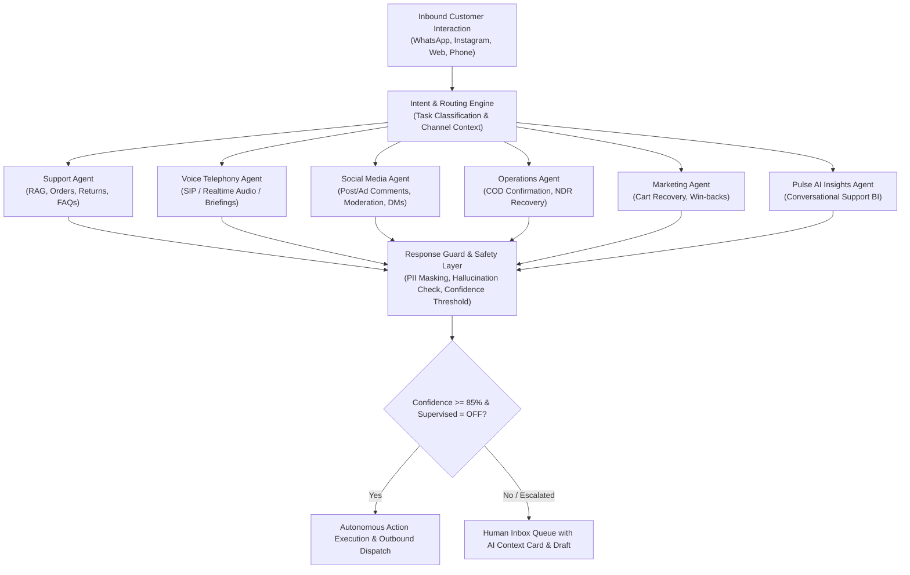
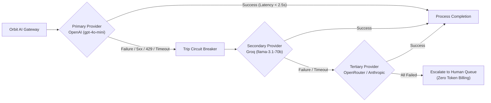
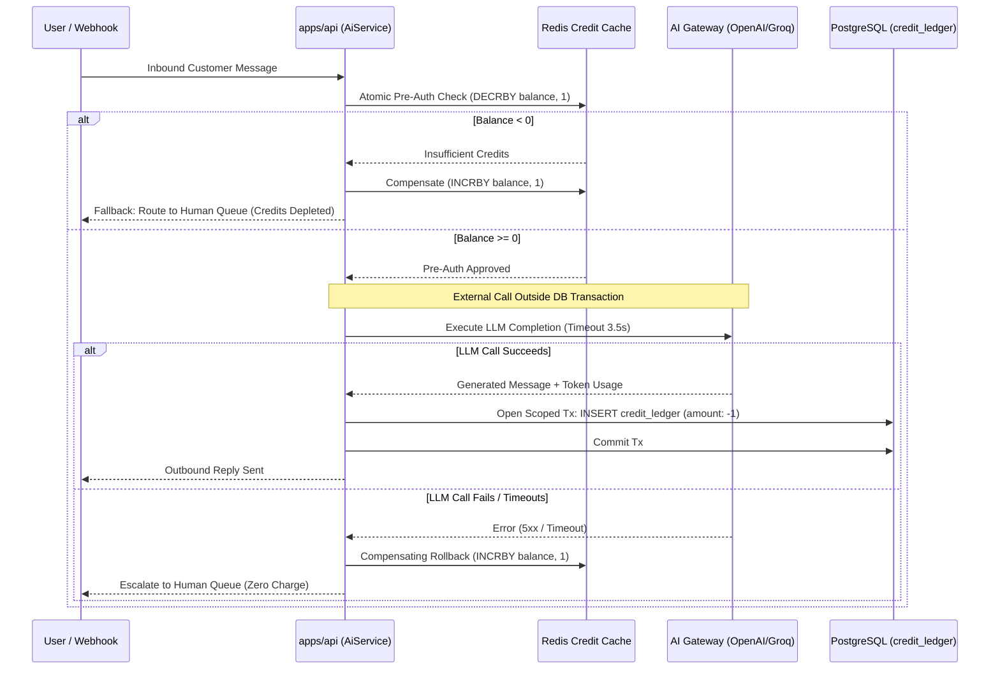

# Orbit AI Workforce & Credit Ledger Architecture
## Multi-Agent Orchestration, Multi-Provider Failover & Double-Entry Financial Accounting

**Document ID:** `AI-20261119-ORBIT-V1`  
**Status:** Approved Architectural Blueprint  
**Enforcement Models:** Decoupled AI Gateway, pgvector Knowledge Retrieval, Transactional Double-Entry Credit Ledger

---

## 1. Multi-Agent Autonomous Workforce Architecture

Project Orbit replaces monolithic single-prompt bots with a fleet of **specialized, domain-trained AI agents** coordinated by an overarching intent router:



### 1.1 The Specialized Agent Fleet

| Agent Persona | Primary Channel Focus | Key Responsibilities & Capabilities | Underlying Model Strategy |
| :--- | :--- | :--- | :--- |
| **1. Support Agent ("Shreya")** | Web Widget, WhatsApp, Instagram DM, Email | Resolves customer inquiries, looks up Shopify orders, initiates return labels, checks stock via pgvector RAG. | `gpt-4o-mini` / `llama-3.1-70b` |
| **2. Voice Agent** | Phone / Telephony (Twilio / SIP) | Handles inbound customer phone calls, streams low-latency speech, detects interruptions, generates written human handoff briefings. | Groq Whisper (STT) + `gpt-4o-mini` + Cartesia / ElevenLabs (TTS) |
| **3. Social Media Manager** | Instagram Feed / Ad Comments, Twitter | Listens to public comments, publishes brand-safe public replies, automatically initiates private DMs, hides spam/toxic comments. | `gpt-4o-mini` |
| **4. Operations Agent** | WhatsApp & SMS Outbound | Automates Cash-on-Delivery (COD) verification calls/messages, resolves Non-Delivery Reports (NDR) with couriers, updates addresses. | `gpt-4o-mini` |
| **5. Marketing Agent** | WhatsApp, SMS, Email | Executes abandoned cart recovery journeys, browse re-engagement, and post-purchase replenishment flows. | `gpt-4o` (Creative copywriting) |
| **6. Pulse AI (Insights BI)** | Business Workspace Split-View | Analyzes support conversations, ticket trends, and uploaded merchant CSVs/spreadsheets; renders live charts beside chat. | `claude-3-5-sonnet` / `gpt-4o` |

---

## 2. Multi-Provider AI Gateway & Resiliency Routing

To achieve production-grade reliability with zero downtime, Orbit implements a **Multi-Provider AI Gateway** featuring dynamic circuit breakers, automated failover, and latency hedging:



### 2.1 Provider Routing Matrix

| Task Type | Primary Model | Backup Model 1 (Groq) | Backup Model 2 (OpenRouter) | Max Latency Timeout |
| :--- | :--- | :--- | :--- | :---: |
| **Fast Chat & Triage** | OpenAI `gpt-4o-mini` | Groq `llama-3.1-70b-versatile` | OpenRouter `mistralai/mistral-large-2407` | 3,500 ms |
| **Complex Order Reasoning** | OpenAI `gpt-4o` | Anthropic `claude-3-5-sonnet` | OpenRouter `openai/gpt-4o` | 8,000 ms |
| **Vector Embeddings** | OpenAI `text-embedding-3-small` | Cohere `embed-english-v3.0` | In-memory Fallback (Warning logged) | 2,000 ms |
| **Speech-to-Text (STT)** | Groq `whisper-large-v3` | OpenAI `whisper-1` | Deepgram Nova-2 | 1,200 ms |
| **Pulse BI Spreadsheet Query**| Anthropic `claude-3-5-sonnet` | OpenAI `gpt-4o` | OpenRouter `google/gemini-pro-1.5` | 12,000 ms |

### 2.2 Circuit Breaker Specification
*   **Trip Threshold:** 3 consecutive failures (HTTP 429, 500, 503, or timeout) within a 30-second rolling window.
*   **Open State Behavior:** Immediately routes all requests to Secondary Provider without attempting Primary.
*   **Half-Open Probe:** After 60 seconds in Open State, dispatches a single test probe request to Primary. If successful, resets breaker to Closed; if failed, remains Open for an additional 120 seconds.

---

## 3. Concurrency-Safe Credit Accounting & Transactional Ledger

Orbit abstracts raw AI token costs into a unified, user-friendly unit of value: **Orbit AI Credits**.

### 3.1 Credit Conversion & Valuation Rules
*   **1 Orbit Credit = 1 Standard Resolved Customer Interaction** (or 1,000 tokens across standard models).
*   **Per-Plan Credit Allowances:**
    *   *Starter Plan (\$29/mo):* 2,000 credits included.
    *   *Growth Plan (\$99.99/mo):* 7,500 credits included (observed in reference screenshot).
    *   *Enterprise Plan:* Custom allowance (e.g., 50,000+ credits).
*   **Credit Consumption Rates:**
    *   Standard Text Chat Turn (`gpt-4o-mini` / `llama-3.1-70b`): `1 Credit`.
    *   Deep Reasoning Chat Turn (`gpt-4o` / `claude-3-5-sonnet`): `3 Credits`.
    *   Voice Telephony Support Minute (STT + LLM + TTS): `5 Credits / minute`.
    *   Pulse BI Spreadsheet Complex Query: `5 Credits`.

### 3.2 Double-Entry Accounting Ledger (`credit_ledger`)

To prevent race conditions, double-spending, and inaccurate billing, every credit movement is recorded in an immutable, append-only database ledger:

```sql
CREATE TABLE credit_ledger (
  id UUID PRIMARY KEY DEFAULT gen_random_uuid(),
  organization_id UUID NOT NULL REFERENCES organizations(id),
  transaction_type VARCHAR(32) NOT NULL, -- SUBSCRIPTION_MINT, TOP_UP, AI_BURN, GOODWILL_GRANT, REFUND
  amount_credits INT NOT NULL,           -- Positive for deposits, negative for burns
  balance_after INT NOT NULL,
  reference_type VARCHAR(32),            -- AI_REQUEST, STRIPE_INVOICE, MANUAL_ADMIN
  reference_id VARCHAR(128),
  remarks VARCHAR(255),
  created_at TIMESTAMPTZ NOT NULL DEFAULT NOW()
);

CREATE INDEX idx_credit_ledger_org_created ON credit_ledger(organization_id, created_at DESC);
```

### 3.3 Concurrency-Safe Debit Protocol (P1 Issue Resolution)
Previous versions ran LLM calls inside database transactions, holding table locks. The revised protocol completely decouples provider calls from database locks while guaranteeing atomic balance enforcement:



---

## 4. Platform-Wide AI Expenditure & Gross Margin Assurance

Platform administrators on Surface C (`apps/admin`) have real-time visibility into AI gross margins:

$$\text{Gross Margin \%} = \frac{\text{Tenant Credit Revenue (USD)} - \text{Raw Provider API Cost (USD)}}{\text{Tenant Credit Revenue (USD)}} \times 100$$

### 4.1 Unit Economics Model
*   **Growth Plan Merchant (\$99.99/month for 7,500 credits):**
    *   Revenue per credit: $\frac{\$99.99}{7,500} \approx \$0.01333 \text{ per credit}$.
    *   Raw Provider Cost (`gpt-4o-mini` average 400 prompt + 150 completion tokens):
        *   Prompt cost: $400 \times \$0.15 / 1,000,000 = \$0.000060$
        *   Completion cost: $150 \times \$0.60 / 1,000,000 = \$0.000090$
        *   Total raw LLM cost per standard interaction: **\$0.000150**
    *   Gross Profit per interaction: $\$0.01333 - \$0.00015 = \$0.01318$
    *   **Gross Margin: 98.8%** on standard text interactions.
*   **Voice Telephony Support Minute (5 credits = \$0.0667 revenue):**
    *   Groq Whisper STT (1 min): \$0.00111
    *   LLM Reasoning (600 tokens): \$0.00020
    *   Cartesia TTS (150 words audio): \$0.00750
    *   Twilio SIP minute: \$0.00400
    *   Total raw voice cost per minute: **\$0.01281**
    *   Gross Profit per voice minute: $\$0.0667 - \$0.0128 = \$0.0539$
    *   **Gross Margin: 80.8%** on voice interactions.

**Governance Directive:** Platform gross margins must never fall below **75%**. If provider price surges occur, the Platform Super-Admin adjusts `AiModelPricingSchedule` or triggers model failover to Groq/OpenRouter.
