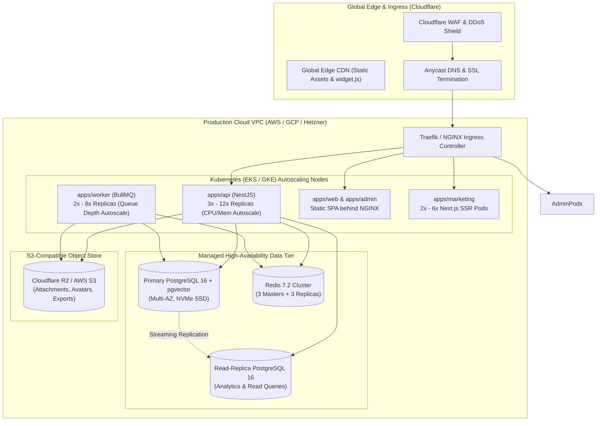

# Orbit Infrastructure & Cloud Cost Plan
## Multi-Stage Deployment Topology, High-Availability Sizing & Unit Economics Modeling

**Document ID:** `INFRA-20261119-ORBIT-V1`  
**Status:** Approved Architectural Blueprint  
**Target Environments:** Local Dev, Staging / Preview, High-Availability Production

---

## 1. Multi-Stage Deployment Topology

---

## 2. Environment Specifications

### 2.1 Local Development Environment
*   **Engine:** Docker Compose (`docker-compose.yml`).
*   **Services:**
    *   PostgreSQL 16 with `pgvector` extension (port `5432`).
    *   Redis 7.2 Alpine (port `6379`).
    *   MinIO (Local S3-compatible storage, port `9000`).
    *   MailHog / Inbucket (Local SMTP testing, port `8025`).
*   **Resource Footprint:** 4 vCPU, 8 GB RAM developer workstation.

### 2.2 Staging & Ephemeral Preview Environment
*   **Engine:** Managed Kubernetes or PaaS (Railway / Render / AWS ECS Fargate).
*   **Database:** Managed PostgreSQL (db.t4g.medium, 2 vCPU, 4 GB RAM) with pgvector.
*   **Cache:** Upstash Serverless Redis or AWS ElastiCache t4g.small.
*   **CI/CD Automation:** Every Pull Request deploys an ephemeral staging preview environment with seeded test tenants and mocked external webhooks.

### 2.3 Production Environment
*   **VPC Architecture:** Private subnets for databases and workers; public subnets for Ingress Controllers.
*   **High Availability:** Multi-AZ automated failover for PostgreSQL (RTO < 60s, RPO = 0).
*   **Zero Egress Storage:** Cloudflare R2 for message media attachments and exports (eliminating expensive AWS S3 data transfer egress fees).
*   **Edge Acceleration:** Cloudflare Enterprise / Business tier with WAF rate limiting, Bot Management, and Brotli compression.

---

## 3. Monthly Infrastructure Cost Projections

Infrastructure expenditures are modeled across three progressive business growth stages:

### Tier 1: Early Pilot Stage (10 – 50 Brands, ~250k Conversations / Month)

| Component | Sizing & Specifications | Estimated Cost (USD) |
| :--- | :--- | :---: |
| **Compute (API & Workers)** | 3x AWS t4g.medium instances / ECS Fargate (2 vCPU, 4 GB RAM) | \$75 / month |
| **Database (PostgreSQL 16)** | AWS RDS PostgreSQL db.t4g.medium (Multi-AZ, 100 GB gp3 SSD) | \$130 / month |
| **Cache (Redis 7.2)** | AWS ElastiCache t4g.micro (Primary + Replica) | \$35 / month |
| **Edge & CDN** | Cloudflare Pro Plan | \$20 / month |
| **Object Storage (R2)** | Cloudflare R2 (50 GB storage, zero egress fees) | \$5 / month |
| **Email & Transactional** | Postmark / SendGrid (25,000 emails/mo) | \$25 / month |
| **Telemetry & Observability** | Datadog / Grafana Cloud (Logs, Traces, Metrics) | \$60 / month |
| **Raw AI Provider APIs** | OpenAI / Groq (avg 250k interactions @ \$0.0002) | \$50 / month |
| **Total Tier 1 Operational Cost**| | **\$400 / month** |

*Projected Monthly Revenue:* 30 Growth plans @ \$99.99 = **\$2,999.70 / month**  
*Gross Operating Margin:* **86.7%**

---

### Tier 2: Growth Stage (100 – 500 Brands, ~5M Conversations / Month)

| Component | Sizing & Specifications | Estimated Cost (USD) |
| :--- | :--- | :---: |
| **Compute (Kubernetes Nodes)** | 4x AWS m7g.xlarge instances (4 vCPU, 16 GB RAM) | \$420 / month |
| **Database (PostgreSQL 16)** | AWS RDS db.r7g.xlarge (Multi-AZ, 500 GB Provisioned IOPS gp3) | \$540 / month |
| **Read Replica (PostgreSQL)**| AWS RDS db.r7g.large (Single-AZ, read queries & analytics) | \$190 / month |
| **Cache (Redis Cluster)** | AWS ElastiCache m7g.large (3 Nodes, High Availability) | \$280 / month |
| **Edge & CDN** | Cloudflare Business Plan (Advanced WAF & Rate Limiting) | \$200 / month |
| **Object Storage (R2)** | Cloudflare R2 (1 TB storage, media attachments) | \$25 / month |
| **Email & SMS Delivery** | Postmark (500k emails) + Twilio SMS notifications | \$350 / month |
| **Telemetry & Observability** | Grafana Cloud / BetterStack (Distributed Tracing & Sentry) | \$220 / month |
| **Raw AI Provider APIs** | OpenAI / Groq (5M interactions with failover) | \$850 / month |
| **Total Tier 2 Operational Cost**| | **\$3,075 / month** |

*Projected Monthly Revenue:* 300 Growth plans @ \$99.99 + Top-ups = **\$34,500 / month**  
*Gross Operating Margin:* **91.1%**

---

### Tier 3: Scale Stage (1,000+ Brands, ~50M Conversations / Month)

| Component | Sizing & Specifications | Estimated Cost (USD) |
| :--- | :--- | :---: |
| **Compute Cluster (EKS)** | 10x AWS c7g.2xlarge Compute-Optimized Worker Nodes | \$1,450 / month |
| **Database (Primary RDS)** | AWS RDS db.r7g.4xlarge (Multi-AZ, 2 TB SSD, io2 Block Express) | \$2,400 / month |
| **Read Replicas (x2)** | 2x AWS RDS db.r7g.2xlarge Read Replicas | \$1,300 / month |
| **Cache (Redis Cluster)** | AWS ElastiCache r7g.xlarge (6 Node Redis Cluster) | \$980 / month |
| **Edge & WAF** | Cloudflare Enterprise (Custom SSL, Bot Management, Zero-Trust) | \$2,500 / month |
| **Object Storage (R2)** | Cloudflare R2 (10 TB storage, attachments, video) | \$150 / month |
| **Email, SMS & Voice** | Postmark + Twilio SIP trunking & carrier minutes | \$2,800 / month |
| **Monitoring & SRE** | Full Datadog APM, PagerDuty, Sentry Enterprise | \$1,200 / month |
| **Raw AI Provider APIs** | OpenAI, Anthropic, Groq blended enterprise volume rates | \$7,500 / month |
| **Total Tier 3 Operational Cost**| | **\$20,280 / month** |

*Projected Monthly Revenue:* 1,000 Brands (mix of Growth & Enterprise) = **\$180,000 / month**  
*Gross Operating Margin:* **88.7%**

---

## 4. Disaster Recovery & Business Continuity (BC/DR)

*   **Recovery Point Objective (RPO):** Maximum 5 minutes. Continuous WAL (Write-Ahead Logging) archiving to S3/GCS with 1-second granularity.
*   **Recovery Time Objective (RTO):** Maximum 15 minutes for complete regional failure.
*   **Automated Backups:**
    *   Daily full database snapshots retained for 35 days.
    *   Weekly snapshot exports stored in secondary cloud region (e.g., AWS us-east-1 to us-west-2).
*   **Database Health Sweepers:**
    *   `apps/worker` continuously audits uncommitted webhook leases and orphan connections every 60 seconds.
