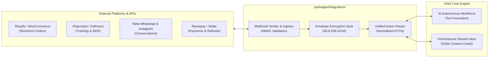

# Orbit Integrations Catalog & Connector Specification
## Comprehensive Inventory, Auth Lifecycles & API Capabilities Across 57+ Pre-Built Integrations

**Document ID:** `INT-20261119-ORBIT-V1`  
**Status:** Approved Architectural Blueprint  
**Reference Grounding:** SagePilot Marketplace (`image(20261119-090430).png`) & Enterprise E-Commerce Specifications

---

## 1. Overview & Integration Architecture

Orbit connectors are organized into a decoupled, pluggable architecture hosted in `packages/integrations`. Every connector implements a standardized lifecycle interface (`IntegrationConnector`):
1.  **Handshake & Auth:** OAuth 2.0 redirect, API Key validation, or Webhook subscription handshake.
2.  **Envelope Encryption:** Third-party tokens are encrypted with AES-256-GCM before database storage in `Channel.config`.
3.  **Inbound Webhook Dispatcher:** Verifies external signatures (HMAC SHA-256), enforces idempotency in `WebhookEvent`, and pushes events into BullMQ queues.
4.  **Action Dispatcher:** Standardized tool actions exposed to AI agents and human agents (e.g., `fetch_order`, `initiate_refund`, `create_return_label`).

---

## 2. Category 1: Commerce & Storefront Connectors

Commerce integrations provide live customer context, order statuses, inventory availability, and order modification actions.

| Connector Name | Auth Lifecycle | Required Scopes / Credentials | Inbound Webhook Triggers | Supported Agent Actions | Current Status | Target Milestone |
| :--- | :--- | :--- | :--- | :--- | :---: | :---: |
| **Shopify** | OAuth 2.0 App | `read_orders`, `write_orders`, `read_customers`, `read_products` | `orders/create`, `orders/updated`, `orders/fulfilled`, `orders/cancelled` | `fetch_customer_orders`, `get_order_details`, `cancel_order`, `issue_refund`, `update_shipping_address` | `D` | M4 |
| **WooCommerce** | REST API Key | Consumer Key, Consumer Secret, Store URL | `order.created`, `order.updated`, `customer.created` | `fetch_orders`, `get_product_stock`, `update_order_status` | `E` | M4 |
| **EasyEcom** | API Token | API Token, Merchant ID | Order status change webhooks | `lookup_oms_order`, `check_warehouse_inventory` | `E` | M4 |
| **Unicommerce** | SOAP / REST API | Client ID, Client Secret, Username | OMS shipment notifications | `fetch_order_status`, `check_item_dispatch` | `E` | M4 |
| **Eshopbox** | API Key | Merchant Secret, Access Key | Fulfillment update webhooks | `track_fulfillment`, `schedule_pickup` | `E` | M4 |
| **Vinculum** | API Token | API Key, Partner Code | Inbound dispatch events | `query_order_lifecycle`, `cancel_sku` | `E` | M4 |
| **Loop Subscriptions**| API Token | Secret Token, Store Domain | Subscription renewal & cancellation webhooks | `pause_subscription`, `skip_next_order`, `update_delivery_frequency` | `E` | M4 |

---

## 3. Category 2: Shipping, Logistics & NDR (Non-Delivery Reports)

Shipping integrations empower AI agents to resolve delivery inquiries autonomously, update addresses, and handle Cash-on-Delivery (COD) / NDR recovery.

| Connector Name | Auth Lifecycle | Required Scopes / Credentials | Event Triggers | Supported Agent Actions | Current Status | Target Milestone |
| :--- | :--- | :--- | :--- | :--- | :---: | :---: |
| **Shiprocket** | API Token (Auto-refresh) | Email, Password, API Secret | `tracking/update`, `ndr/raised` | `track_awb`, `re-attempt_delivery`, `update_delivery_address`, `cancel_shipment` | `E` | M4 |
| **ShipStation** | Basic Auth | API Key, API Secret | `SHIP_NOTIFY` webhook | `get_shipment_tracking`, `void_label` | `E` | M4 |
| **NimbusPost** | API Token | Access Token, Client Email | NDR status notifications | `track_shipment`, `schedule_ndr_reattempt` | `E` | M4 |
| **Shipway** | API Key | API Key, Merchant ID | Real-time tracking status pushes | `get_tracking_history`, `notify_customer` | `E` | M4 |
| **Shadowfax** | REST API Key | Client Token, Store Code | Courier status change webhooks | `fetch_hyperlocal_status`, `assign_rider` | `E` | M4 |
| **Ekart Logistics** | API Token | Merchant Key, Access Token | Milestone delivery webhooks | `track_consignment`, `flag_address_issue` | `E` | M4 |
| **Proship** | API Token | Host, API Secret, Tenant ID | Carrier manifests & tracking pushes | `get_multi_carrier_tracking` | `E` | M4 |
| **Velocity Shipping**| API Key | API Key | Milestone events | `track_awb_live` | `E` | M4 |
| **Shipmozo** | API Token | Partner Token | NDR updates | `update_rto_status`, `trigger_ndr_call` | `E` | M4 |

---

## 4. Category 3: Returns & Exchange Automation

Returns integrations allow AI agents to validate return windows, verify eligibility policies, generate reverse pickup labels, and issue store credit.

| Connector Name | Auth Lifecycle | Required Scopes / Credentials | Event Triggers | Supported Agent Actions | Current Status | Target Milestone |
| :--- | :--- | :--- | :--- | :--- | :---: | :---: |
| **ReturnPrime** | API Key | Public Key, Secret Key | `return/created`, `return/approved`, `pickup/completed` | `create_return_request`, `generate_reverse_awb`, `issue_exchange_order` | `E` | M4 |
| **AfterShip Returns** | API Key | API Key | `return_received`, `refund_approved` | `lookup_return_status`, `approve_return` | `E` | M4 |
| **ClickPost** | API Key | Account Key, Username | Tracking & NDR webhooks | `initiate_return_pickup`, `track_return_awb` | `E` | M4 |
| **EcoReturns** | OAuth 2.0 | Client Secret, Store URL | Return lifecycle events | `verify_return_eligibility`, `generate_qr_label` | `E` | M4 |

---

## 5. Category 4: Payments & Checkout

Payment integrations provide order payment verification, automated partial/full refunds, and COD-to-prepaid conversion loops.

| Connector Name | Auth Lifecycle | Required Scopes / Credentials | Inbound Webhooks | Supported Agent Actions | Current Status | Target Milestone |
| :--- | :--- | :--- | :--- | :--- | :---: | :---: |
| **Razorpay** | Basic Auth | Key ID, Key Secret, Webhook Secret | `payment.captured`, `payment.failed`, `refund.processed` | `verify_payment_status`, `issue_instant_refund`, `create_payment_link` | `E` | M4 |
| **Razorpay Magic Checkout**| API Key | Merchant ID, Secret | `order.checkout_created`, `order.paid` | `track_magic_checkout`, `send_prepaid_discount_link` | `E` | M4 |
| **Stripe** | API Key | Secret Key (`sk_live_...`), Webhook Signing Secret (`whsec_...`) | `payment_intent.succeeded`, `invoice.paid`, `customer.subscription.updated` | `create_billing_portal_session`, `issue_refund`, `create_top_up_checkout` | `B` | M1 / M3 |
| **Petpooja** | API Key | App Key, Restaurant ID | Order status notifications | `fetch_restaurant_order`, `update_kitchen_status` | `E` | M4 |
| **Cashfree** | API Key | Client ID, Client Secret | `PAYMENT_SUCCESS_WEBHOOK` | `verify_upi_payment`, `create_payout_refund` | `E` | M4 |

---

## 6. Category 5: Communication Channels

Communication channels represent the customer-facing conversational interfaces.

| Channel Name | Protocol / SDK | Auth Lifecycle | Capabilities | Current Status | Target Milestone |
| :--- | :--- | :--- | :--- | :---: | :---: |
| **Web Chat Widget** | Shadow DOM JS Bundle | Workspace Public API Key | Rich text, Markdown, Image upload, Typing indicator, CSAT rating | `A` (Engine) / `B` (UI) | M2 |
| **Meta WhatsApp** | WhatsApp Cloud API | Meta Permanent System Token, Phone ID, WABA ID | 2-way text, media attachments, interactive quick-reply buttons, template messages | `C` (Mock) | M1 (Real SDK) |
| **Meta Instagram** | Instagram Graph API | Facebook Page Access Token, App Secret | Instagram Direct Messages (DM), Feed Comments, Ad Comments, Story Mentions | `C` (Mock) | M1 (Real SDK) |
| **Email (IMAP/SMTP/SES)**| Inbound Webhook / SMTP | AWS SES Credentials or Custom SMTP/IMAP | Inbound thread parsing, HTML email rendering, DKIM signed outbound replies | `E` | M2 |
| **Voice / Telephony** | SIP / WebRTC / Twilio | Twilio Account SID, Auth Token, Twilio Phone Number | Inbound/outbound phone support, low-latency STT/TTS audio streaming, human handoff | `E` | M6 |

---

## 7. Category 6: Agentic Protocols & Developer Tooling

| Connector Name | Standard / Format | Capabilities | Target Milestone |
| :--- | :--- | :--- | :---: |
| **Model Context Protocol (MCP)** | Model Context Protocol Specification (JSON-RPC) | Allows external AI clients (Claude Desktop, Cursor, ChatGPT) to inspect tickets, customer orders, and trigger actions | M5 |
| **Outbound Webhooks** | HTTP POST with HMAC SHA-256 Signatures | Real-time event streaming (`ticket.created`, `ticket.resolved`, `csat.submitted`) to merchant data warehouses | M3 |
| **JavaScript Client SDK** | Browser NPM package (`@orbit/client-sdk`) | Tracking user cart additions, page views, and embedding in-app support buttons | M3 |
| **Public REST API** | OpenAPI 3.0 / Swagger | Full programmatic CRUD across tickets, customers, knowledge chunks, and usage | M3 |
