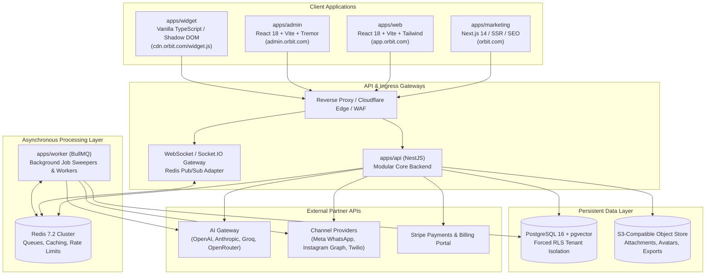
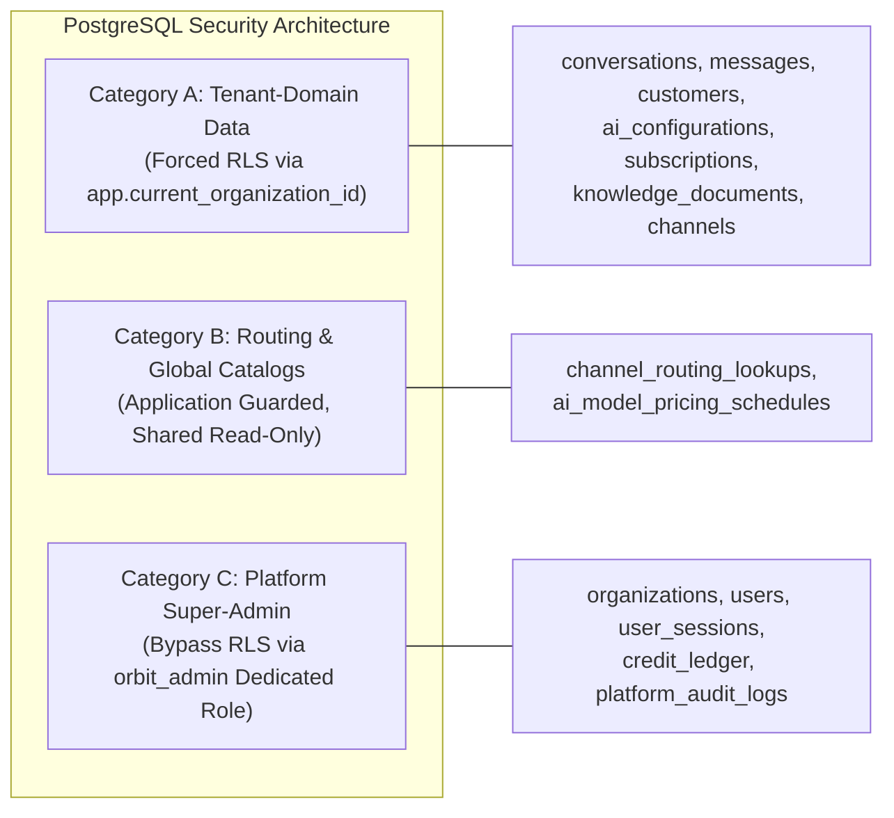
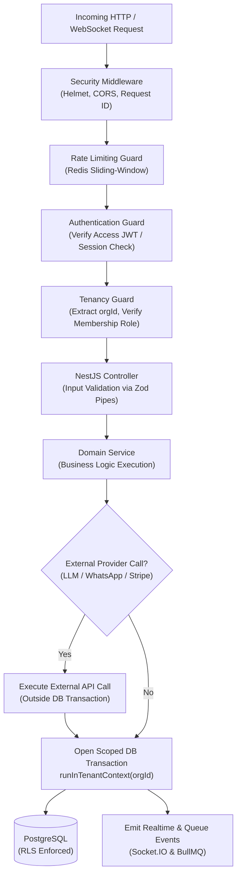

# Orbit Product Architecture Specification
## Unified System Architecture Across Public Ingress, Business Workspaces & Platform Control Plane

**Document ID:** `ARCH-20261119-ORBIT-V1`  
**Status:** Approved Architectural Blueprint  
**Monorepo Engine:** Turborepo with pnpm workspaces

---

## 1. High-Level System Architecture

Project Orbit utilizes a modular, high-throughput monorepo architecture engineered to decouple the high-traffic public marketing engine, the real-time business workspace console, and the privileged platform administration plane while sharing foundational database schemas, validation rules, and third-party integrations.



---

## 2. Monorepo Package Layout

```
orbit/
├── apps/
│   ├── marketing/          # Surface A: Public website, landing pages, ROI calculator, SEO (Next.js)
│   ├── web/                # Surface B: Business Workspace multi-tenant dashboard (React + Vite)
│   ├── admin/              # Surface C: Platform-Owner Admin super-administrative console (React + Vite)
│   ├── api/                # Core NestJS REST and WebSocket backend
│   ├── widget/             # Standalone client chat widget bundle (Zero-dependency Shadow DOM)
│   └── worker/             # BullMQ background job processor and cron sweepers
├── packages/
│   ├── config/             # Environment validation, typed environment constants
│   ├── db/                 # Prisma client, migrations, RLS helpers, seeders
│   ├── integrations/       # Adapters for AI (OpenAI/Groq), Channels (Meta/Twilio), Storage (S3/R2)
│   ├── logger/             # Structured Pino logger with trace context and PII redaction
│   ├── shared/             # Common TypeScript interfaces, DTOs, Enums, and constants
│   ├── ui/                 # Shared Tailwind design system tokens and headless UI components
│   └── validation/         # Zod schemas shared across frontend and backend
```

---

## 3. Database Architecture & RLS Strategy

The PostgreSQL database enforces three distinct isolation categories to guarantee zero cross-tenant data leakage while enabling platform-wide administration.



### 3.1 Tenant Isolation via Forced Row-Level Security (RLS)
*   **Database Roles:**
    *   `orbit_app`: Unprivileged runtime role used by `apps/api` and `apps/worker` for tenant requests. `NOBYPASSRLS` is explicitly enforced.
    *   `orbit_admin`: Privileged runtime role used exclusively by `apps/admin` and platform-level ledger syncs.
    *   `orbit_migration`: Dedicated migration runner role owning table schemas.
*   **RLS Policy Pattern:**
    All Category A tables contain an `organization_id UUID NOT NULL` column and an immutable RLS policy:
    ```sql
    ALTER TABLE conversations ENABLE ROW LEVEL SECURITY;
    ALTER TABLE conversations FORCE ROW LEVEL SECURITY;

    CREATE POLICY tenant_isolation_policy ON conversations
      FOR ALL
      TO orbit_app
      USING (organization_id = NULLIF(current_setting('app.current_organization_id', true), '')::uuid)
      WITH CHECK (organization_id = NULLIF(current_setting('app.current_organization_id', true), '')::uuid);
    ```
*   **Transaction Runner:**
    Every API request executing tenant business logic must execute within a scoped transaction via `runInTenantContext(orgId, tx)`:
    ```typescript
    await prisma.$executeRawUnsafe(
      `SELECT set_config('app.current_organization_id', $1, true)`,
      organizationId
    );
    ```

### 3.2 Recommended Schema Extensions for Full Parity

To achieve 100% parity with SagePilot references, the Prisma schema must be extended with the following models in Milestone 2 through Milestone 6:

```prisma
// ==============================================================================
// EXTENSION 1: TEAMS & GRANULAR WORKSPACE RBAC
// ==============================================================================
model Team {
  id             String   @id @default(uuid()) @db.Uuid
  organizationId String   @map("organization_id") @db.Uuid
  name           String   @db.VarChar(64)
  description    String?  @db.VarChar(255)
  createdAt      DateTime @default(now()) @map("created_at") @db.Timestamptz()
  updatedAt      DateTime @default(now()) @updatedAt @map("updated_at") @db.Timestamptz()

  organization Organization @relation(fields: [organizationId], references: [id], onDelete: Cascade)
  memberships  TeamMembership[]
  conversations Conversation[]

  @@unique([id, organizationId], name: "uq_teams_id_org")
  @@index([organizationId])
  @@map("teams")
}

model TeamMembership {
  id             String   @id @default(uuid()) @db.Uuid
  organizationId String   @map("organization_id") @db.Uuid
  teamId         String   @map("team_id") @db.Uuid
  userId         String   @map("user_id") @db.Uuid
  createdAt      DateTime @default(now()) @map("created_at") @db.Timestamptz()

  team Team @relation(fields: [teamId, organizationId], references: [id, organizationId], onDelete: Cascade)

  @@unique([teamId, userId], name: "uq_team_memberships_team_user")
  @@map("team_memberships")
}

// ==============================================================================
// EXTENSION 2: TICKET CUSTOM FIELDS, TAGS & DISPOSITIONS
// ==============================================================================
model TicketField {
  id             String   @id @default(uuid()) @db.Uuid
  organizationId String   @map("organization_id") @db.Uuid
  name           String   @db.VarChar(64)
  fieldType      String   @map("field_type") @db.VarChar(32) // TEXT, NUMBER, DROPDOWN, CHECKBOX
  options        Json     @default("[]")
  isRequired     Boolean  @default(false) @map("is_required")
  createdAt      DateTime @default(now()) @map("created_at") @db.Timestamptz()

  @@unique([id, organizationId], name: "uq_ticket_fields_id_org")
  @@map("ticket_fields")
}

model TicketTag {
  id             String   @id @default(uuid()) @db.Uuid
  organizationId String   @map("organization_id") @db.Uuid
  name           String   @db.VarChar(64)
  colorHex       String   @default("#10B981") @map("color_hex") @db.VarChar(7)
  category       String   @default("GENERAL") @db.VarChar(32)
  createdAt      DateTime @default(now()) @map("created_at") @db.Timestamptz()

  @@unique([organizationId, name], name: "uq_ticket_tags_org_name")
  @@map("ticket_tags")
}

// ==============================================================================
// EXTENSION 3: CSAT SURVEYS & INFERRED CSAT SCORES
// ==============================================================================
model CsatSurvey {
  id             String    @id @default(uuid()) @db.Uuid
  organizationId String    @map("organization_id") @db.Uuid
  conversationId String    @unique @map("conversation_id") @db.Uuid
  customerId     String    @map("customer_id") @db.Uuid
  surveyRating   Int?      @map("survey_rating") // 1 to 5 stars
  inferredRating Decimal?  @map("inferred_rating") @db.Decimal(3, 2) // AI predicted 1.00 - 5.00
  feedbackText   String?   @map("feedback_text") @db.Text
  closureEvidence String?  @map("closure_evidence") @db.Text
  attributedAgentId String? @map("attributed_agent_id") @db.Uuid
  createdAt      DateTime  @default(now()) @map("created_at") @db.Timestamptz()

  @@unique([id, organizationId], name: "uq_csat_surveys_id_org")
  @@index([organizationId, surveyRating])
  @@index([organizationId, inferredRating])
  @@map("csat_surveys")
}

// ==============================================================================
// EXTENSION 4: TRANSACTIONAL CREDIT LEDGER (DOUBLE-ENTRY)
// ==============================================================================
model CreditLedger {
  id             String   @id @default(uuid()) @db.Uuid
  organizationId String   @map("organization_id") @db.Uuid
  transactionType String  @map("transaction_type") @db.VarChar(32) // SUBSCRIPTION_MINT, TOP_UP, AI_BURN, GOODWILL_GRANT, REFUND
  amountCredits  Int      @map("amount_credits") // Positive for mint/grant, negative for burn
  balanceAfter   Int      @map("balance_after")
  referenceType  String?  @map("reference_type") @db.VarChar(32) // AI_REQUEST, STRIPE_INVOICE, MANUAL_ADMIN
  referenceId    String?  @map("reference_id") @db.VarChar(128)
  remarks        String?  @db.VarChar(255)
  createdAt      DateTime @default(now()) @map("created_at") @db.Timestamptz()

  @@unique([id, organizationId], name: "uq_credit_ledger_id_org")
  @@index([organizationId, createdAt])
  @@map("credit_ledger")
}

// ==============================================================================
// EXTENSION 5: SOCIAL ENGAGEMENT & REPUTATION MANAGEMENT
// ==============================================================================
model SocialPost {
  id             String   @id @default(uuid()) @db.Uuid
  organizationId String   @map("organization_id") @db.Uuid
  channelId      String   @map("channel_id") @db.Uuid
  platform       String   @db.VarChar(32) // INSTAGRAM, TWITTER
  externalPostId String   @map("external_post_id") @db.VarChar(128)
  postType       String   @default("FEED") @map("post_type") @db.VarChar(24) // FEED, AD, STORY
  mediaUrl       String?  @map("media_url") @db.VarChar(512)
  caption        String?  @db.Text
  postedAt       DateTime @map("posted_at") @db.Timestamptz()
  createdAt      DateTime @default(now()) @map("created_at") @db.Timestamptz()

  comments SocialComment[]

  @@unique([channelId, externalPostId], name: "uq_social_posts_channel_ext")
  @@unique([id, organizationId], name: "uq_social_posts_id_org")
  @@map("social_posts")
}

model SocialComment {
  id                String   @id @default(uuid()) @db.Uuid
  organizationId    String   @map("organization_id") @db.Uuid
  postId            String   @map("post_id") @db.Uuid
  externalCommentId String   @map("external_comment_id") @db.VarChar(128)
  authorHandle      String   @map("author_handle") @db.VarChar(128)
  commentText       String   @map("comment_text") @db.Text
  status            String   @default("OPEN") @db.VarChar(24) // OPEN, HIDDEN, DELETED, DM_INITIATED, RESOLVED
  sentiment         String?  @db.VarChar(24) // POSITIVE, NEUTRAL, NEGATIVE
  createdAt         DateTime @default(now()) @map("created_at") @db.Timestamptz()

  post SocialPost @relation(fields: [postId, organizationId], references: [id, organizationId], onDelete: Cascade)

  @@unique([postId, externalCommentId], name: "uq_social_comments_post_ext")
  @@unique([id, organizationId], name: "uq_social_comments_id_org")
  @@map("social_comments")
}

// ==============================================================================
// EXTENSION 6: PLATFORM SUPER-ADMIN AUDIT TRAIL
// ==============================================================================
model PlatformAuditLog {
  id             String   @id @default(uuid()) @db.Uuid
  adminUserId    String   @map("admin_user_id") @db.Uuid
  action         String   @db.VarChar(64) // TENANT_SUSPEND, IMPERSONATE, CREDIT_GRANT, ROUTING_CHANGE
  targetTenantId String?  @map("target_tenant_id") @db.Uuid
  targetUserId   String?  @map("target_user_id") @db.Uuid
  ipAddress      String   @map("ip_address") @db.VarChar(45)
  userAgent      String   @map("user_agent") @db.VarChar(255)
  payloadBefore  Json?    @map("payload_before")
  payloadAfter   Json?    @map("payload_after")
  createdAt      DateTime @default(now()) @map("created_at") @db.Timestamptz()

  @@index([adminUserId, createdAt])
  @@index([targetTenantId, createdAt])
  @@map("platform_audit_logs")
}
```

---

## 4. API & Layered Backend Architecture

`apps/api` follows a strictly modular NestJS architecture with deterministic request processing pipelines:



### 4.1 Resolution of Critical P1 Blockers in Architecture

1.  **AI Provider Call Decoupling:**
    *   *Defect:* `AiService.generateSuggestion` previously executed `provider.generateResponse()` inside a PostgreSQL transaction.
    *   *Architectural Fix:* Strict 3-phase execution:
        *   Phase 1 (Pre-flight DB Tx): Read conversation context and knowledge embeddings inside `runInTenantContext`. Check credit balance. Record `AiRequest` in `PENDING` state. Commit and close DB transaction immediately.
        *   Phase 2 (External Provider): Execute LLM request via AI Gateway with timeout (8,000ms) and retry logic. Database holds zero locks.
        *   Phase 3 (Post-flight DB Tx): Open new scoped transaction via `runInTenantContext`. Record `AiRequestAttempt`, atomic credit deduction in `CreditLedger`, and insert generated message or internal note.
2.  **Credential Envelope Encryption:**
    *   *Defect:* Channel tokens stored in plaintext JSONB (`Channel.config`).
    *   *Architectural Fix:* AES-256-GCM envelope encryption implemented in `packages/integrations`. Channel secrets are encrypted before database insertion using a tenant-unique data key encrypted by a platform KMS master key.
3.  **Tiered Redis Rate Limiting:**
    *   *Architectural Fix:* NestJS `ThrottlerModule` backed by Redis cluster sliding window:
        *   `/api/auth/login`, `/api/auth/register`: 5 requests per minute per IP.
        *   `/api/auth/refresh`: 30 requests per minute per user family.
        *   `/api/ai/*`: 60 requests per minute per organization token bucket.
        *   Public Webhooks (`/api/webhooks/*`): 1,000 requests per minute with signature verification.
4.  **Stripe Webhook RLS Deadlock Fix:**
    *   *Defect:* `StripeIngestionService` queries `subscriptions` as `orbit_app` without tenant context, returning 0 rows.
    *   *Architectural Fix:* Stripe customer metadata (`stripe_customer_id` and `organizationId`) is mapped in Category B global routing lookup `StripeCustomerRoutingLookup`. Webhook extracts `orgId` first, then runs subscription update within `runInTenantContext(orgId)`.

---

## 5. Asynchronous Worker & Queue Pipeline

`apps/worker` utilizes BullMQ backed by Redis 7.2 with isolated queue processors:

| Queue Name | Concurrency | Priority | Job Responsibilities |
| :--- | :---: | :---: | :--- |
| `webhooks-inbound` | 20 | High | Ingesting and verifying signatures for WhatsApp, Instagram, Stripe events |
| `ai-orchestration` | 10 | Medium | Background RAG embeddings, AI draft generation, conversation summarization |
| `telephony-voice` | 30 | Urgent | Low-latency audio packet processing, STT/TTS streaming, briefing generation |
| `marketing-campaigns` | 5 | Low | Scheduled WhatsApp/Email broadcast dispatch, delivery tracking |
| `sweeper-maintenance`| 1 | Low | Webhook lease timeout renewal, dead-letter retries, session cleanup |

---

## 6. Realtime Communication Architecture

Realtime bidirectional state sync is powered by **Socket.IO** attached to `apps/api` with `@socket.io/redis-adapter` for multi-instance clustering:
*   **Authentication:** JWT verified during WebSocket handshake (`useRealtimeSocket.ts`).
*   **Room Partitioning:** Clients automatically join scoped rooms:
    *   `org:${organizationId}`: Broadcasts new tickets, ticket status changes, and notifications.
    *   `conv:${conversationId}`: Broadcasts typing indicators, new messages, internal notes, and AI responses.
    *   `user:${userId}`: Personal mentions and direct assignments.
*   **Presence Tracking:** Redis hashes track online status of human agents (`agent:presence:${orgId}`).

---

## 7. Model Context Protocol (MCP) Architecture

Project Orbit implements a standards-compliant **Model Context Protocol (MCP)** server endpoint at `/api/mcp` allowing external agentic tools (Claude Desktop, Cursor, ChatGPT) to interact securely with a business workspace:
*   **Authentication:** Scoped Workspace MCP API Key (`Bearer orb_mcp_...`).
*   **Exposed MCP Tools:**
    *   `orbit_search_tickets`: Filter and read customer conversations and metadata.
    *   `orbit_get_customer_context`: Unified customer profile, orders, and interaction timeline.
    *   `orbit_post_internal_note`: Add private team context to an ongoing ticket.
    *   `orbit_trigger_action`: Execute authorized actions (e.g., process refund, trigger WhatsApp notification).
*   **Audit Logging:** Every MCP tool invocation is logged in `ai_requests` with `provider: "MCP"` and billed to the workspace credit ledger.
