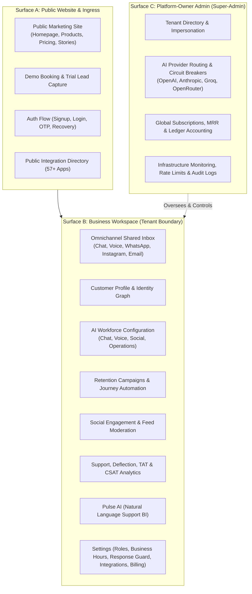
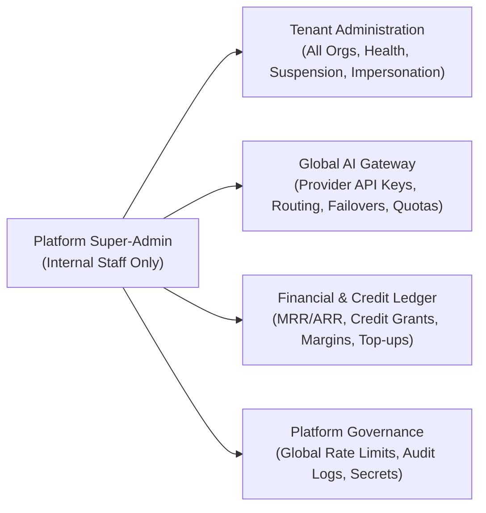

# Orbit Product Scope Specification
## Complete Product Scope Across Public Website, Business Workspace & Platform Administration

**Document ID:** `SCOPE-20261119-ORBIT-V1`  
**Status:** Approved Architectural Blueprint  
**Target Parity Reference:** SagePilot Platform (`https://www.sagepilot.ai/` & Workspace Artifacts)

---

## 1. Executive Product Architecture

Project Orbit is engineered as an enterprise-grade, multi-tenant AI customer engagement platform designed specifically for modern consumer brands, D2C merchants, and omnichannel retail operations. The product delivers autonomous AI workforce execution across support, voice, social engagement, operations, and retention marketing while maintaining human-in-the-loop governance.

The platform comprises **three strictly isolated product surfaces**:
1. **Public Website (`apps/marketing`):** High-converting marketing, product storytelling, ROI validation, self-serve onboarding, and public lead capture.
2. **Business Workspace (`apps/web`):** Multi-tenant SaaS operational cockpit utilized by brand owners, support leads, human agents, and growth marketers.
3. **Platform-Owner Admin (`apps/admin`):** Super-administrative control plane for platform operators governing multi-tenant health, global AI providers, model routing, credit ledgers, subscriptions, and security infrastructure.

---

## 2. Surface A: Public Website Specification

The public website serves as the primary acquisition engine. It must communicate enterprise credibility, demonstrate AI capabilities interactively, and convert high-volume merchants.

### 2.1 Marketing Homepage
*   **Hero Section:** Value proposition ("The Autonomous AI Workforce for Consumer Brands"), live interactive simulation toggle (demonstrating AI resolving an order refund, exchange, and delivery query), social proof logos, primary CTAs ("Book a Demo", "Start Free Trial").
*   **Omnichannel Grid:** Visual breakdown of supported engagement touchpoints (WhatsApp, Instagram DM & Feed, Web Chat, Phone/Voice, Email).
*   **Interactive ROI Calculator:** Dynamic slider inputs for monthly ticket volume, current human agent count, and average first-response time; calculates annual dollar savings, hours reclaimed, and expected resolution rate (70%–85% target).
*   **Customer Proof Bar:** Verified metrics from real-world deployments (e.g., Plum: 12x surge capacity, 94% peak AI resolution; Aachho: 60k monthly tickets automated; Freecultr: 2x repeat purchases).
*   **AI Workforce Showcase:** Dedicated cards presenting the specialized autonomous employees (Support Agent, Voice Agent, Social Manager, Operations Agent, Marketing Agent).
*   **Customer Testimonials & Case Studies:** Carousel of founder and VP Customer Experience quotes with measurable business outcomes.
*   **Security & Compliance Trust Badges:** SOC2 readiness, GDPR compliance, ISO 27001 posture, encryption in transit/rest badges.

### 2.2 Product Detail Pages
*   **Autonomous Support AI:** AI customer service closing end-to-end loops via live OMS, courier, and ERP integrations.
*   **AI Voice Agent:** Inbound and outbound telephony on a single phone line, conversational speech synthesis, automated human handoff with full written briefing.
*   **Marketing & Retention AI:** AI-driven browse/cart abandonment recovery, post-purchase replenishment journeys, win-back campaigns on WhatsApp and SMS.
*   **Operations & Logistics AI:** Cash-on-delivery (COD) confirmation, Non-Delivery Report (NDR) recovery, automated exchange and return management.
*   **Omnichannel Shared Inbox:** Universal agent console unifying all customer threads with Shopify order cards, internal team notes, and AI copilot suggestions.
*   **Analytics & Pulse AI:** Deep support business intelligence with conversational natural language querying over customer tickets and uploaded spreadsheets.

### 2.3 AI Workforce Directory
*   Fleet overview detailing agent capabilities, autonomy levels, supervised review mode, and supported integrations for each agent persona.

### 2.4 Customer Stories & Case Studies
*   In-depth case study library with filterable industries (Fashion, Beauty, Electronics, Home Decor).
*   Standard case structure: Challenge, AI Agent Deployment, Integrations Used, Quantified Results (Deflection %, CSAT increase, First Response Speedup).

### 2.5 Pricing & Packaging Page
*   **Three Standard Tiers:**
    *   **Starter Plan:** Entry-level for scaling brands ($29/month base + pay-as-you-go credits). Includes 2,000 AI credits, 2 team seats, Web Widget + Email.
    *   **Growth Plan ($99.99/month):** For growing DTC operations (as observed in workspace references). Includes 7,500 AI credits, 5 team seats, WhatsApp + Instagram, Shopify integration, standard SLA tracking.
    *   **Enterprise Plan (Custom Quote):** Custom volume allowances, dedicated Slack support, custom AI fine-tuning/RAG embeddings, Voice telephony, SSO/SAML, custom security SLA.
*   **Credit Consumption & Top-Up Explainer:** Clear transparent unit economics explaining token-to-credit conversion, voice minute credit burn, and rollover policies.
*   **Interactive Pricing Tier Selector:** Sliders based on monthly active conversations and channel requirements.
*   **Frequently Asked Questions (FAQ):** 12 comprehensive questions addressing setup time, agent autonomy governance, and data privacy.

### 2.6 Integrations Directory
*   Searchable catalog of 57+ pre-built connectors grouped into 7 categories (Commerce, Shipping/Logistics, Returns, Loyalty/Reviews, Payments, Webhooks/Ops, AI/LLMs).
*   Dedicated integration detail pages explaining trigger events, supported actions, and setup prerequisites.

### 2.7 Lead Generation & Demo Scheduling
*   Multi-step qualification modal: Brand Name, Website URL, Monthly Ticket Volume (<1k, 1k-10k, 10k-50k, 50k+), Primary Channels, Current Helpdesk.
*   Direct calendar booking embed (Cal.com / Google Calendar) with automatic CRM lead routing and calendar invites.

### 2.8 Authentication & Access
*   Clean, accessible authentication screens: Sign Up, Log In, Password Reset, Magic Link / Email OTP, and Google OAuth.

### 2.9 Legal, Trust & Corporate Pages
*   Terms of Service, Privacy Policy, Subprocessors List, Data Processing Agreement (DPA), Security Whitepaper, About Us, and Contact Us.

---

## 3. Surface B: Business Workspace Specification

The Business Workspace is the multi-tenant SaaS cockpit. It is organized into 6 core functional operational pillars encompassing 31 modular areas:

### Pillar 1: Omnichannel Inbox & Ticket Management
1.  **Shared Inbox & Ticket Console:**
    *   3-column modern interface: Left ticket list, center conversation thread, right metadata & context drawer.
    *   Ticket Views & Navigation: All, In Queue, Open, Reopened, Mentions, Assigned to Me, Snoozed, Awaiting Reply, Investigating, Escalated, Needs Reply, Needs First Reply.
    *   Shared & Private Custom Views: Custom filter views saved across team or personal workspace.
    *   Conversation Thread: Customer chat bubbles, rich media (images, PDFs), AI messages with green attribution badges, system event logs (e.g., "Shreya fetched Shopify orders"), and Private Team Notes (yellow background with `Private` badge).
    *   Quick Action Bar: Keyboard shortcuts (`R` for Reply, `N` for Private Note, `S` for Ask Sage AI copilot).
    *   Right Context Panel:
        *   Ticket Details: Status dropdown, Priority (Low, Medium, High, Urgent), Assignee selector, Team assignment, Timeline audit trail, Tags selector.
        *   Contact Details: Customer Name, Email (clickable mailto), Phone (clickable tel), First Seen date, Channel source icon.
        *   Customer Properties: Custom attributes (e.g., VIP status, total spend, churn risk).
        *   Commerce Integration Cards: Real-time Shopify/WooCommerce order cards displaying order number, item thumbnails, delivery status, tracking links, and one-click refund/cancel action buttons.
        *   Recent Tickets List: Historical customer tickets with resolution statuses.

### Pillar 2: Customers & CRM
2.  **Unified Contact Directory:**
    *   Searchable customer database across email, phone, name, and channel identities.
    *   Multi-channel identity linking: Unifying a customer's WhatsApp phone number, Instagram handle, and Web Widget cookie into one canonical customer ID.
    *   Customer merge & deduplication engine with complete audit logging (`CustomerMergeAudit`).
    *   Full interaction timeline aggregating past conversations, orders, and support ratings.

### Pillar 3: Autonomous AI Workforce Management
3.  **AI Chat Agents:**
    *   Agent personas (e.g., "Shreya" - Customer Care Agent).
    *   Prompt engineering studio: System instructions, tone of voice, greeting messages.
    *   Knowledge Base RAG: Embedding documents, FAQs, policy URLs, and product catalogs into pgvector.
    *   Channel deployment selector: WhatsApp, Instagram, Web Widget, Email.
4.  **AI Voice Agents:**
    *   Telephony integration (SIP trunking / Twilio Voice) sharing a single brand phone number between AI and human agents.
    *   Real-time speech-to-text (STT) and low-latency text-to-speech (TTS).
    *   Intelligent human transfer: Automatic generation of a written summary briefing displayed in the agent inbox when a customer asks to speak with a human.
5.  **Social Agents & Comment Management:**
    *   Social Media Manager persona monitoring Instagram post comments, Ad comments, and Twitter mentions.
    *   Automated public replies according to brand safety guidelines.
    *   Automated "Initiate DM" workflows converting public complaints into private resolution threads.
    *   Moderation actions: Automated hiding or deletion of toxic/spam comments.
6.  **Response Guard & Trust Controls:**
    *   Supervised Review Mode: AI drafts responses for human review before autonomy is granted.
    *   Confidence thresholds: Automatically handing off queries when model confidence falls below a configured threshold (e.g., 85%).
    *   Policy guardrails: Strict PII redaction, blacklisted competitor names, hallucination defense, and anti-jailbreak filters.
7.  **Context & Memory Settings:**
    *   Configurable context token windows, conversation summarization triggers, and external metadata injection rules.

### Pillar 4: Marketing Campaigns & Retention Automation
8.  **Campaign Management & Customer Journeys:**
    *   Targeted broadcast campaigns across WhatsApp, SMS, and Email.
    *   Triggered lifecycle journeys: Abandoned checkout recovery, browse abandonment, order delivered follow-up, win-back re-engagement.
    *   Message delivery status tracking: Stacked status breakdowns across Cancelled, Delivered, Failed, Read, Retrying, Scheduled, and Sent.
9.  **Marketing Management Settings:**
    *   Email Domains: Custom DKIM, SPF, and DMARC verification for verified branded sending.
    *   Attribution: Revenue tracking attributed to AI support interactions and recovery campaigns.
    *   Brand Identity: Guidelines on tone, emojis, language style, and multilingual localization.

### Pillar 5: Deep Analytics & Pulse Business Intelligence
10. **Open Tickets & Backlog Analytics:**
    *   KPI cards: Total Open, Human Handling, AI Handling, Unassigned.
    *   Distributions: Sub-status breakdown, priority breakdown, inferred CSAT breakdown.
    *   Ticket age distribution: 0-24h, 1-2 days, 1 week - 1 month, Over 1 month; cross-tabulated by human/AI agent and channel.
11. **Performance & Turnaround Time (TAT):**
    *   Metrics split by AI and human agents: Closed tickets, First Response TAT adherence (24h target), Resolution TAT adherence (72h target).
    *   Trend charts: TAT adherence over time, CSAT trends, average interactions per ticket.
    *   Time distribution histograms: First response time buckets (<1h, 1-4h, 4-24h, 1-3d) and resolution time buckets.
12. **Ticket Trends & Message Volumes:**
    *   Total conversation count trends over time (open vs total).
    *   Message breakdown by type: Customer messages, AI messages, Human messages.
    *   Tag trends: Conversation volume stacked by categorizations (e.g., Shipping & Delivery, Order Status, Exchange & Returns, Payment & Billing, Damaged Item).
    *   Channel distribution trends.
13. **Workforce Analytics:**
    *   Median response time and median resolution time (Human vs AI).
    *   Queue analytics: Entered queue, assigned from queue, currently in queue, median queue wait time.
    *   Workload distribution: Issues by assignee by week, issues by channel source.
14. **AI Deflection Analytics:**
    *   Daily stacked bar chart of tickets handled fully by AI vs humans.
    *   AI deflection percentage line curve (e.g., measuring autonomous resolution without human intervention).
15. **CSAT & Customer Satisfaction Reporting:**
    *   Dual CSAT measurement: Direct Customer Survey CSAT vs AI-Inferred CSAT (sentiment-analyzed conversations).
    *   1 to 5 star rating distributions (Excellent, Good, Neutral, Poor, Very Poor).
    *   Agent CSAT leaderboard with closure evidence and last-reply timestamps.
16. **Touchpoints & Interaction Funnel:**
    *   Distribution of closed tickets by number of interactions (1-2, 3-5, 6-10, 11-20, 21-50, 50+).
    *   Touchpoints per handler: Average touchpoints to closure for AI vs human agents.
17. **Busiest Times Heatmap:**
    *   Hourly aggregate activity heatmap (0:00 to 23:00) mapped across days of the week (Monday through Sunday) for conversations and messages.
    *   Hourly agent activity breakdowns.
18. **Social Engagement Analytics:**
    *   Overview cards: Inbound comments, active posts, reply coverage %, reply + DM %, moderated %.
    *   Sankey comment handling flow: Inbound comments -> Public reply vs ignored -> Outcomes (Awaiting action, Hidden, Deleted, Moved to DM).
    *   Timeline activity charts over time.
19. **Pulse AI (Insights AI Assistant):**
    *   Natural language analytics copilot ("Ask anything about your support data or uploaded spreadsheets").
    *   One-click suggestion prompts: "How many tickets did we get this week vs last week?", "What share of tickets did AI handle fully this month?", "Break down open tickets by age".
    *   File attachment support: Ability to upload CSV/Excel files (inventory, distributor reports, sales figures) for AI analysis.
    *   Dynamic live report generator displayed in split-view alongside the chat conversation.

### Pillar 6: Workspace Settings & Platform Administration
20. **Workspace General & Business Hours:**
    *   Workspace name, logo, primary timezone (e.g., GMT+5:30).
    *   Weekly operating schedule per day (start/end times), holiday calendar, out-of-office automated messaging, queue routing rules outside business hours.
21. **Members, Roles & Teams:**
    *   Role-Based Access Control (RBAC): `OWNER`, `ADMIN`, `MEMBER`, `AGENT`.
    *   Team definitions: e.g., Customer Support, Escalations, Sales, VIP Support.
    *   Member invitation workflows with role assignments and seat limit enforcement.
22. **Ticket Fields & Call Dispositions:**
    *   Custom ticket metadata schema (text, dropdown, numeric, checkbox).
    *   Call wrap-up dispositions for phone support (e.g., "Resolved - Refund Issued", "Transferred to Logistics").
    *   Mandatory fields required before ticket resolution.
23. **Ticket Sub-statuses, Enrichment & Tags:**
    *   Configurable sub-statuses (Investigating, Awaiting Reply, Snoozed, Pending Vendor).
    *   Automated ticket enrichment rules and tag classification taxonomy.
24. **CSAT Configuration & Email Blocking:**
    *   Survey dispatch triggers (on resolution, after delay), rating scale settings (1-5 stars vs CSAT emoji).
    *   Email spam filtering and automated domain blocking rules.
25. **Channels & Marketplace Integrations:**
    *   Channel connectors: Web Chat Widget, WhatsApp Cloud API, Instagram Graph API, Email (IMAP/SMTP/SES), Voice (Twilio/SIP).
    *   57+ third-party integrations across Commerce (Shopify, WooCommerce, EasyEcom), Shipping (Shiprocket, ShipStation, NimbusPost), Payments (Razorpay, Stripe), and Ops.
26. **Model Context Protocol (MCP) Server:**
    *   Built-in Orbit MCP endpoint allowing external AI clients (Claude Desktop, Cursor, ChatGPT) to query workspace tickets, customer context, and knowledge base.
27. **Developer API Details & API Keys:**
    *   Workspace API keys with granular read/write permission scopes.
    *   API documentation, rate limit counters, and key rotation controls.
28. **SDK Events & Event Webhooks:**
    *   Client-side JavaScript SDK configuration for web tracking and custom event dispatching.
    *   Outbound webhook endpoints subscribing to ticket events, customer updates, and order triggers with HMAC signature verification.
29. **Usage & AI Token Consumption:**
    *   Real-time token usage meters, message counts by channel, storage consumption.
30. **Billing, Wallet & Plans:**
    *   Current plan status (e.g., Growth $99.99/mo [Active]), billing renewal date.
    *   AI credit consumption meter (e.g., "7,304 left of 7,500 used").
    *   Subscription credit balance vs one-time top-up credit wallet.
    *   Direct Stripe Customer Portal integration for invoice downloads and card management.
31. **Personal Profile, Notifications & Workspace Exports:**
    *   User details, avatar, sound alerts, desktop notifications.
    *   Full workspace data exports (CSV/JSON), GDPR data portability requests, workspace deletion.

---

## 4. Surface C: Platform-Owner Admin Specification

The Platform-Owner Admin is the super-administrative control plane (`apps/admin`). It is completely segregated from tenant workspaces and is accessible strictly to authorized Orbit platform operators.

### 4.1 Tenant & Organization Administration
*   **Global Tenant Directory:** Searchable index of all registered organizations, creation dates, current plan tier, seat counts, active channel count, and operational status (`ACTIVE`, `SUSPENDED`, `DELETED`).
*   **Tenant Health & Diagnostic Inspector:** Live inspection of tenant queue health, webhook ingestion errors, failed jobs, and active webhook leases.
*   **Secure Impersonation Engine:** Cryptographically auditable session assumption allowing platform engineers to view a tenant workspace in read-only or authorized support mode with mandatory reason logging and automated session expiry.
*   **Tenant Suspension & Feature Gating:** Ability to instantly suspend rogue tenants or selectively enable beta feature flags (e.g., Voice AI, MCP Server, Social Agent) per organization.

### 4.2 Platform User Administration
*   Directory of all global user accounts across organizations.
*   Force session revocation, password reset triggers, and account lockout for security incidents.

### 4.3 Subscription & Revenue Administration
*   **MRR, ARR & Churn Analytics:** Real-time visibility into Monthly Recurring Revenue, Annual Recurring Revenue, plan upgrades, downgrades, and cancellations.
*   **Dunning & Payment Recovery:** Tracking past-due subscriptions, failed Stripe invoices, and automated grace period enforcement.
*   **Custom Enterprise Contracts:** Assigning bespoke plan terms, custom seat allocations, and custom AI credit allowances to enterprise accounts.

### 4.4 Credit Ledger & Financial Controls
*   **Platform-Wide Credit Ledger:** Double-entry accounting ledger recording every credit minted (via subscription renewal or top-up purchase) and every credit burned (via AI requests).
*   **Manual Credit Grants & Adjustments:** Platform operators can issue promotional credits, goodwill allowances, or refund consumed credits with mandatory audit remarks.
*   **AI Cost vs Revenue Margin Dashboard:** Tracking true provider token expenditure (USD paid to OpenAI/Anthropic/Groq) against revenue collected per tenant to guarantee positive gross margins.

### 4.5 Global AI Provider Gateway & Routing
*   **Provider Management:** Centralized management of platform master API keys for OpenAI, Anthropic, Groq, and OpenRouter.
*   **Model Routing Matrix:** Configurable routing rules mapping task types to optimal models (e.g., RAG embeddings -> OpenAI `text-embedding-3-small`; fast conversational replies -> Groq `llama-3.1-70b` / OpenAI `gpt-4o-mini`; deep multi-step reasoning -> Anthropic `claude-3-5-sonnet` / OpenAI `gpt-4o`).
*   **Dynamic Circuit Breaker & Failover:** Automatic fallback to backup providers upon rate limits, 5xx server errors, or latency spikes (>4,000ms), preventing user-facing downtime.

### 4.6 Integration & Webhook Health Monitoring
*   Global monitoring of Meta WhatsApp Cloud API and Instagram webhook throughput.
*   Dead-letter queue (DLQ) inspector for failed external webhooks with manual retry replay capabilities.
*   Carrier and partner status dashboard tracking third-party API availability.

### 4.7 Platform Security, Audit & Maintenance
*   **Immutable Audit Trail:** Append-only log recording every administrative action, plan modification, impersonation event, and credential change.
*   **Maintenance & Announcement Banners:** Global banner management displaying scheduled maintenance or feature release notices to all workspace users.
*   **Platform Secret & Encryption Key Management:** Overseeing master KMS encryption keys used for database envelope encryption.

---

## 5. Architectural Boundary Summary

| Feature / Domain | Surface A: Public Website | Surface B: Business Workspace | Surface C: Platform-Owner Admin |
| :--- | :--- | :--- | :--- |
| **Target Audience** | Prospective merchants, public visitors | Brand staff, support agents, workspace owners | Internal Orbit operations & engineering |
| **Authentication** | Anonymous / Lead capture / Auth entry | Tenant JWT with org-scoped claims | Hardware MFA + Super-Admin JWT |
| **Data Boundary** | Public marketing CMS & static assets | Strict PostgreSQL RLS (`app.current_organization_id`) | Global bypass / Multi-tenant view |
| **Primary Goal** | Education, ROI proof, self-serve conversion | Omnichannel customer resolution & retention | Platform stability, revenue & AI unit economics |
| **Application Package** | `apps/marketing` (Next.js / Astro) | `apps/web` (React / Vite) | `apps/admin` (React / Vite / Next.js) |
