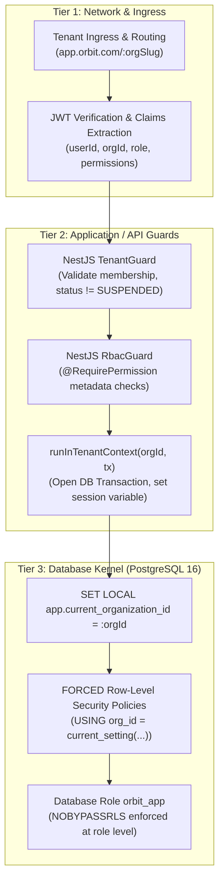
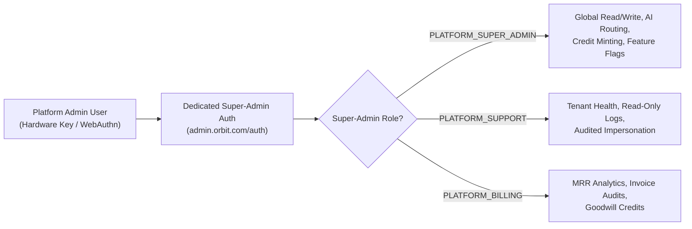

# Orbit RBAC & Multi-Tenant Security Model
## Comprehensive Authorization Matrix, PostgreSQL RLS Policies & Super-Admin Privileges

**Document ID:** `RBAC-20261119-ORBIT-V1`  
**Status:** Approved Architectural Blueprint  
**Enforcement Layers:** PostgreSQL RLS (Kernel), NestJS Guards (API), UI Component Gating (Client)

---

## 1. Multi-Tenant Isolation Architecture

Project Orbit enforces a **Defense-in-Depth Multi-Tenancy Architecture** where tenant boundaries are validated across three distinct software tiers:



### 1.1 PostgreSQL Kernel Isolation (Row-Level Security)
*   **Database User Separation:**
    *   `orbit_app`: Unprivileged application role. All tenant application traffic runs as `orbit_app`. It is explicitly created with `NOBYPASSRLS`. Even if an SQL injection vulnerability were present in application code, queries cannot read rows belonging to another `organization_id`.
    *   `orbit_admin`: Privileged internal platform role with `BYPASSRLS`. Used strictly by platform-owner administration services and global financial auditing scripts.
    *   `orbit_migration`: Schema DDL owner role used during CI/CD migrations.
*   **Forced RLS Directives:**
    All Category A tables have `FORCE ROW LEVEL SECURITY` enabled:
    ```sql
    ALTER TABLE conversations FORCE ROW LEVEL SECURITY;
    ALTER TABLE messages FORCE ROW LEVEL SECURITY;
    ALTER TABLE customers FORCE ROW LEVEL SECURITY;
    ALTER TABLE customer_channel_identities FORCE ROW LEVEL SECURITY;
    ALTER TABLE ai_configurations FORCE ROW LEVEL SECURITY;
    ALTER TABLE knowledge_documents FORCE ROW LEVEL SECURITY;
    ALTER TABLE knowledge_chunks FORCE ROW LEVEL SECURITY;
    ALTER TABLE subscriptions FORCE ROW LEVEL SECURITY;
    ```
*   **Composite Key Integrity:**
    Every foreign key linking Category A tables includes `organization_id` in the relation to eliminate cross-tenant pointer tampering:
    ```sql
    CONSTRAINT fk_messages_conversation_org
      FOREIGN KEY (conversation_id, organization_id)
      REFERENCES conversations(id, organization_id)
      ON DELETE RESTRICT;
    ```

---

## 2. Business Workspace RBAC Matrix

Within an individual tenant workspace (`Organization`), access is governed by granular permissions mapped to four distinct operational roles:

| Permission Key | Description | `OWNER` | `ADMIN` | `MEMBER` | `AGENT` |
| :--- | :--- | :---: | :---: | :---: | :---: |
| **Workspace Governance** | | | | | |
| `org:delete` | Delete entire workspace | ✅ | ❌ | ❌ | ❌ |
| `org:transfer_ownership` | Transfer ownership to another user | ✅ | ❌ | ❌ | ❌ |
| `org:update_settings` | Edit company name, timezone, logo | ✅ | ✅ | ❌ | ❌ |
| `org:manage_business_hours`| Configure working hours & holiday schedules | ✅ | ✅ | ❌ | ❌ |
| `org:view_audit_logs` | View internal workspace audit logs | ✅ | ✅ | ❌ | ❌ |
| **Team & Member Management** | | | | | |
| `members:invite` | Invite new human staff members | ✅ | ✅ | ❌ | ❌ |
| `members:remove` | Remove human staff members | ✅ | ✅ | ❌ | ❌ |
| `members:change_role` | Change member roles (up to self level) | ✅ | ✅ | ❌ | ❌ |
| `teams:manage` | Create, edit, and assign teams | ✅ | ✅ | ❌ | ❌ |
| **Inbox & Ticket Operations** | | | | | |
| `tickets:view_all` | View all ticket queues in the workspace | ✅ | ✅ | ✅ | ❌ (Team/Assigned) |
| `tickets:reply` | Send public customer replies | ✅ | ✅ | ✅ | ✅ |
| `tickets:internal_notes` | Add private team notes | ✅ | ✅ | ✅ | ✅ |
| `tickets:assign` | Assign tickets to self or other agents | ✅ | ✅ | ✅ | ❌ (Self only) |
| `tickets:change_status` | Open, snooze, or resolve tickets | ✅ | ✅ | ✅ | ✅ |
| `tickets:delete` | Permanently delete tickets | ✅ | ✅ | ❌ | ❌ |
| `tickets:manage_custom_fields`| Configure ticket fields & dispositions | ✅ | ✅ | ❌ | ❌ |
| **Customers & CRM** | | | | | |
| `customers:view` | Search and view customer profiles | ✅ | ✅ | ✅ | ✅ |
| `customers:edit` | Edit customer contact info & custom properties | ✅ | ✅ | ✅ | ❌ |
| `customers:merge` | Execute customer profile merges | ✅ | ✅ | ❌ | ❌ |
| `customers:export` | Export customer lists to CSV/JSON | ✅ | ✅ | ❌ | ❌ |
| **AI Workforce & Knowledge** | | | | | |
| `ai:configure_agents` | Edit system prompts, temperature, persona | ✅ | ✅ | ❌ | ❌ |
| `ai:configure_response_guard`| Edit safety thresholds and PII redaction | ✅ | ✅ | ❌ | ❌ |
| `knowledge:upload` | Upload documents and URLs to Knowledge Base | ✅ | ✅ | ✅ | ❌ |
| `knowledge:delete` | Remove knowledge chunks and documents | ✅ | ✅ | ❌ | ❌ |
| **Marketing & Social** | | | | | |
| `campaigns:create` | Launch broadcast campaigns | ✅ | ✅ | ❌ | ❌ |
| `social:moderate` | Hide, delete, or reply to social comments | ✅ | ✅ | ✅ | ✅ |
| `social:initiate_dm` | Convert social comment to private DM | ✅ | ✅ | ✅ | ✅ |
| **Analytics & Reporting** | | | | | |
| `analytics:view_support` | View TAT, CSAT, and open ticket metrics | ✅ | ✅ | ✅ | ❌ |
| `analytics:view_financials`| View revenue attribution & deflection ROI | ✅ | ✅ | ❌ | ❌ |
| `pulse:query` | Use Pulse AI natural language analytics | ✅ | ✅ | ✅ | ❌ |
| **Integrations & Billing** | | | | | |
| `integrations:install` | Connect Shopify, WhatsApp, Meta channels | ✅ | ✅ | ❌ | ❌ |
| `api_keys:manage` | Generate workspace API & MCP keys | ✅ | ✅ | ❌ | ❌ |
| `billing:manage` | Upgrade plans, buy credit top-ups, edit cards | ✅ | ❌ | ❌ | ❌ |

---

## 3. Team-Level Access Scoping

To support enterprise support operations with specialized departments, tickets can be scoped to distinct **Teams**:
*   **Team Types:** e.g., "Tier 1 Frontline", "Technical Escalations", "VIP Concierge", "Billing & Refunds".
*   **Queue Routing Rules:** Inbound tickets from specific channels or tagged with specific keywords automatically route to a designated Team.
*   **Agent Team Scoping:** Users with the `AGENT` role only have visibility into tickets assigned to their primary Team or explicitly assigned to their `userId`, preventing information overload and maintaining organizational boundaries.

---

## 4. Platform-Owner Super-Administrator Security Model

The Platform-Owner Admin (`apps/admin`) is completely decoupled from the multi-tenant Business Workspace:



### 4.1 Super-Admin Roles
1.  **`PLATFORM_SUPER_ADMIN`:** Full global access. Can rotate master KMS keys, alter global AI routing, suspend tenants, and grant enterprise credits.
2.  **`PLATFORM_SUPPORT_ADMIN`:** Access to system health, DLQ inspections, and short-lived audited tenant impersonation. Cannot access credit minting or global API keys.
3.  **`PLATFORM_BILLING_ADMIN`:** Access to financial analytics, Stripe sync dashboards, and goodwill credit issuance up to a configured threshold (\$250 max).

### 4.2 Secure Tenant Impersonation Protocol
Platform operators often need to troubleshoot customer configurations directly. Orbit implements a cryptographically secure, fully audited impersonation mechanism:
1.  **Authorization:** Operator must provide a valid support ticket reference ID and explicit business reason.
2.  **Token Generation:** Platform generates an ephemeral JWT (valid for maximum 60 minutes) containing:
    ```json
    {
      "sub": "user_admin_uuid",
      "orgId": "target_tenant_uuid",
      "role": "MEMBER",
      "isImpersonation": true,
      "realAdminUserId": "user_admin_uuid",
      "ticketId": "SUPPORT-9912",
      "exp": 1732029600
    }
    ```
3.  **Audit Enforcement:** Every API request executed using an impersonation token is intercepted by `ImpersonationAuditInterceptor`, recording the exact route, method, IP address, and payload delta into `platform_audit_logs`.
4.  **UI Indicator:** Business Workspace renders an unclosable, persistent red alert bar at the top of all screens to ensure complete transparency.
5.  **Financial Masking:** While impersonating, all credit card numbers, Stripe customer IDs, and sensitive webhook secret keys are strictly redacted in API responses.
